<div align="center">

<a href="https://focus.linma.asia/">
  
</a>

# 小猫专注 · Kitten Focus

**把时间留给认真生活的自己 · 专注此刻，陪小猫一起长大**

一款免登录、离线可用的 Android 专注与日常学习应用  
把**常驻待办、单局动物陪伴、一周农场、三档防分心、白噪音、时间轴课表与统计**安静地装进同一个 App 里

<p>
  <a href="https://github.com/cjx-bc/kitten-focus/releases/latest">
    
  </a>
  <a href="https://focus.linma.asia/">
    
  </a>
  
  
</p>

<p>
  
  
  
  
  
  
</p>

<p>
  <a href="#story">📖 我们的故事</a> ·
  <a href="#preview">📸 界面一览</a> ·
  <a href="#why">💡 为什么选它</a> ·
  <a href="#install">📱 下载安装</a> ·
  <a href="#companion">🐾 专注与百兽</a> ·
  <a href="#protection">🛡️ 三档防分心</a> ·
  <a href="#architecture">🏗️ 技术与开发</a> ·
  <a href="#roadmap">🗺️ 后续计划</a>
</p>

</div>

---

<a id="story"></a>

## 📖 我们的故事：为什么要自己做「小猫专注」？

如果你也在备考、读大学，或者下班后想静下心学点东西，大概率遇到过这些让人烦躁的小事：

- 手机里装了三四个效率软件——**一个记课表、一个列待办、一个开倒计时、一个用来锁机**，每天在几个 App 之间切来切去；
- 刚想静下心开始学习，打开软件先看 5 秒摇一摇开屏广告，想看一年的数据统计要开会员，想用个基础功能还非得注册账号、把个人日程传到云端；
- “背单词”“刷高数”明明是每天都要重复做的事，普通待办软件却总要你打勾划掉，明天还得重新建一遍；
- 偶尔想用防分心功能管住自己别刷短视频，要么权限折腾半天、杀一下后台就失效，要么遇到界面一堆吓人的红字报错，连正常开始计时都被挡在门外。

我们一直很喜欢**黑白手帐那样干净、安静、打开就能立刻开始**的专注感觉，同时也想让安卓手机上能有一个真正顺手、把日常学习和陪伴养成揉在一起的工具。

于是就有了 **小猫专注**。

从第一版只能离线计时、排课表的小工具开始，一路迭代到现在的 **`v0.3.1`**，我们始终守着一件很简单的事：**不打扰、不卖焦虑、不用登录、打开就能立刻投入眼前这一件事，然后把你认真过的每一段时光，都真真切切留下来。**

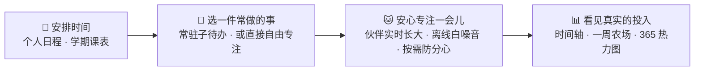

---

<a id="audience"></a>

## 🎯 它是写给谁用的？

| 适合人群 | 日常使用场景 | 小猫专注能帮你做什么 |
| --- | --- | --- |
| 🎓 **在校学生 & 备考党**<br>（大学 / 考研 / 考公 / 期末周） | 每天要对照课表、反复刷题背单词，在图书馆或宿舍容易顺手刷起短视频 | 多学期教学周课表 + 常驻 `子待办` 反复点开就计时；图书馆听 5 路离线白噪音，拔耳机自动暂停不社死；开「轻看护」或「学霸模式」帮你稳住手 |
| 💻 **下班充电 & 自学者** | 晚上只有一两小时清净时间，想专心读本书、写代码或备考证书 | 启动直达专注待机首屏，手指一滑调好时长直接开跑；没有广告弹窗、没有社交排行攀比，安安静静按自己的节奏来 |
| 🐾 **喜欢陪伴感与记录的人** | 纯数字倒计时太枯燥，半途放弃也没什么实感，总想给努力留点纪念 | 专注过程中小动物随进度 3 阶段长大，攒好感解锁 12 只百兽和毛色皮肤；周末一键导出「一周农场」或「一周四色时间图」留档 |
| 🔒 **看重隐私与离线体验的人** | 不想为了记个日程和专注记录就交出手机号、绑定云账号 | 彻底免登录、无后台强制同步；所有数据保存在手机本地 SQLite，随时可导出 JSON 备份文件自己保管 |

---

<a id="preview"></a>

## 📸 应用界面一览（v0.3.1 实机界面）

全应用坚持黑白灰大留白、圆润等宽数字 `Nunito` 与克制的朱红强调。打开软件的第一眼，就是干净的专注页面：

<table>
  <tr>
    <td align="center" width="33%">
      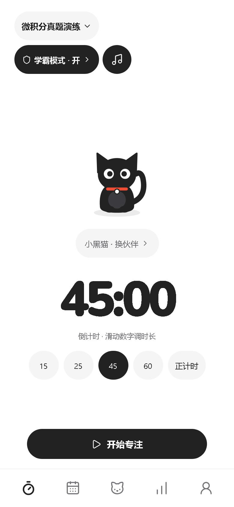
      <br /><b>⏱️ 专注待机首屏</b><br /><sub>打开即专注 · 滑数字调时 · 白噪音与学霸直达</sub>
    </td>
    <td align="center" width="33%">
      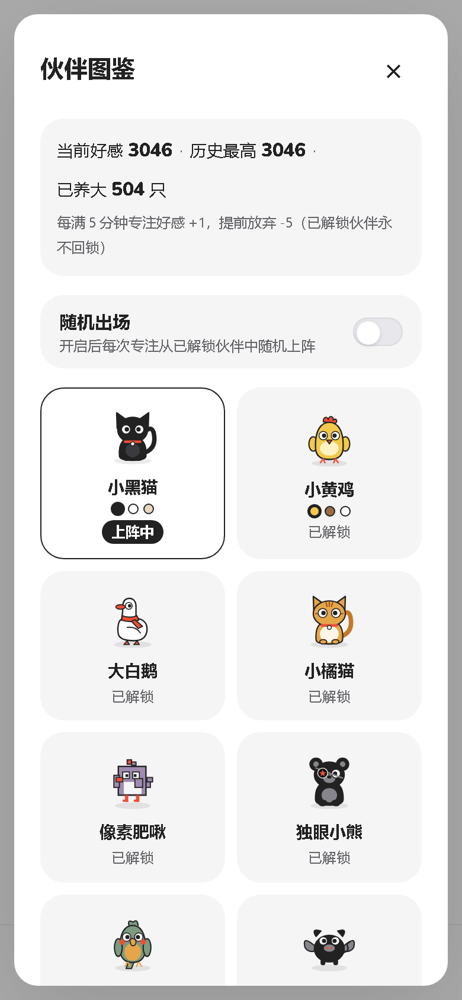
      <br /><b>🐾 12 只百兽图鉴</b><br /><sub>攒好感与成就解锁 · 支持多款毛色皮肤</sub>
    </td>
    <td align="center" width="33%">
      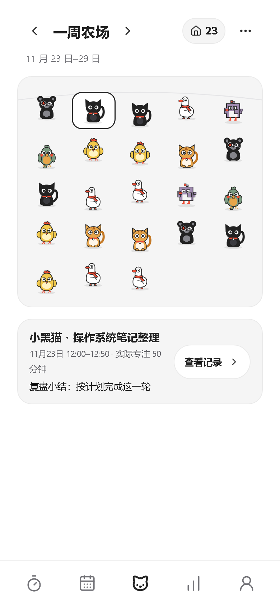
      <br /><b>🌿 一周农场</b><br /><sub>本周养大的伙伴在草坡散步 · 点按看专注记录</sub>
    </td>
  </tr>
  <tr>
    <td align="center" width="33%">
      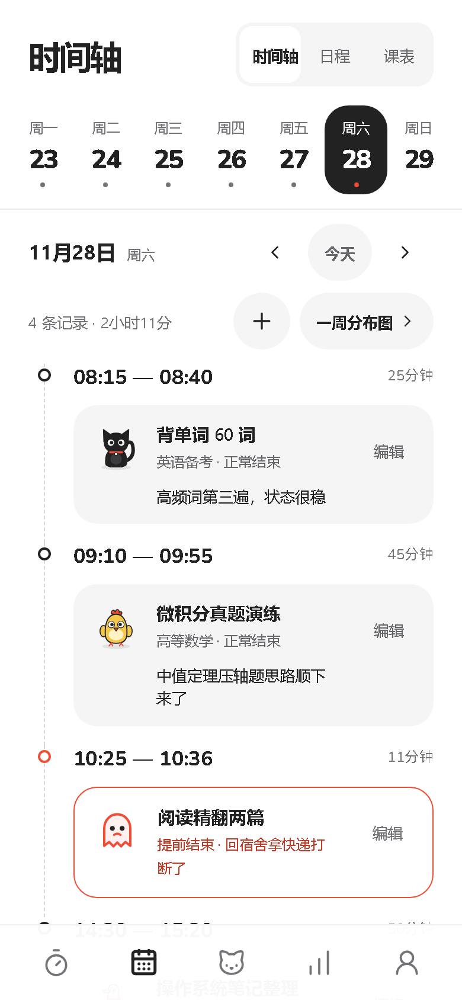
      <br /><b>📅 时间轴 · 日程 · 课表</b><br /><sub>成功伙伴与放弃小幽灵 · 写复盘小结 · 四色周图</sub>
    </td>
    <td align="center" width="33%">
      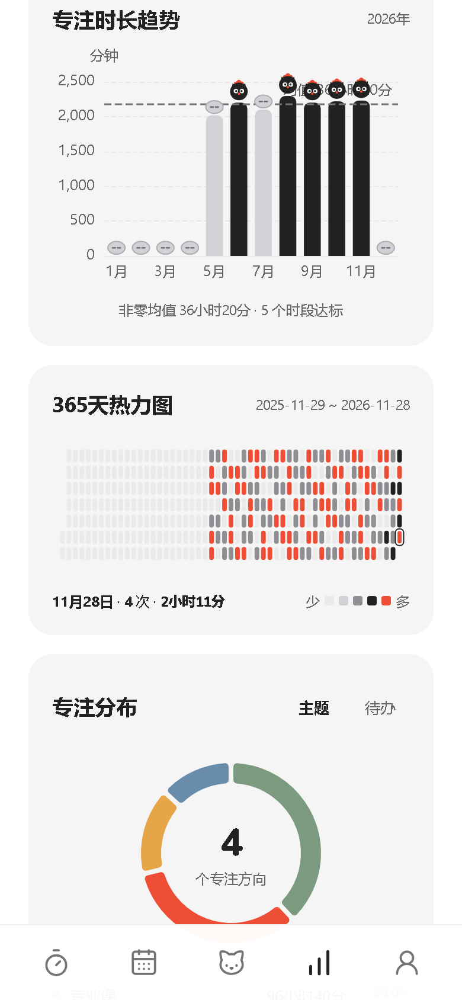
      <br /><b>📊 统计与 365 热力图</b><br /><sub>动物头趋势柱 · 年度热力图 · 主题占比分布</sub>
    </td>
    <td align="center" width="33%">
      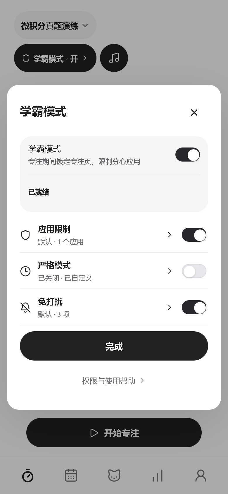
      <br /><b>🛡️ 学霸模式</b><br /><sub>应用限制 / 严格模式 / 免打扰 · 清爽不啰嗦</sub>
    </td>
  </tr>
</table>

---

<a id="why"></a>

## 💡 为什么选择小猫专注？（我们的优势）

不画大饼、不踩一捧一，只把我们在日常使用里最在意的 6 件事老老实实做好：

| 常见专注软件让人头疼的地方 | 🐱 小猫专注是怎么做的 |
| --- | --- |
| 🚫 **开屏广告、会员墙、强制登录** | **零广告、免登录、全功能离线可用。** 不用注册账号，年统计、365 热力图、白噪音、防分心和备份导入导出全都直接开放，数据完完全全留在你自己的设备上。 |
| 🔁 **天天做的事要反复建待办、打勾消失** | **常驻 `子待办` 设计。** “英语 → 背单词”建好一次就一直留着，每天点一下直接开跑，没有完成勾选框和每日重置；具体几点做什么，交给日历和课表（见 [ADR 0003](docs/adr/0003-reusable-focus-items.md)）。 |
| ⚖️ **防分心太极端：要么没用，要么动不动掉权卡死** | **三档防分心按需渐进，讲真话不吹牛。** 不想开权限就用 0 权限「轻看护」；需要硬拦截就开「学霸模式」（日常用免掉权双引擎，重启也不丢权限）；绝不宣称“绝对无法强停”，任何时候 2 步就能进紧急出口和故障恢复。 |
| 😴 **纯倒计时干巴巴，放弃也没有实感** | **单局实时养成 + 温和的仪式感。** 专注时伙伴分 3 阶段实时长大，前 10 秒点错了可以无责撤回；超过 10 秒主动放弃或切屏太久不回来，小动物会挂掉并扣 5 点好感（已解锁伙伴永不回锁）。 |
| 🎧 **图书馆开白噪音怕断连外放社死、锁屏断音** | **5 路离线 `.wav` 白噪音**（雨声、鸟鸣、溪流、篝火、海浪），独立音量控制、锁屏不断音；拔耳机或蓝牙断开瞬间自动静音暂停，不用手忙脚乱。 |
| 📉 **记了一堆时间却看不清自己的真实节奏** | **从一局到一年的清晰回看。** 时间轴支持写 `复盘小结`、手动补录忘开计时的线下学习（单独隔离不刷好感）、一键生成「一周 24 小时四色打卡图」和「本周农场打卡图」，还有 5 周期统计与 365 天年度热力图。 |

---

<a id="install"></a>

## 📱 下载、安装与更新

### 📦 获取 Android 安装包

| 渠道 | 地址 | 说明 |
| --- | --- | --- |
| 🌐 **官网下载页（推荐）** | [**https://focus.linma.asia/**](https://focus.linma.asia/) | 免登录，默认提供免费代理候选线路，同时保留自有服务器和 GitHub 原站备用下载 |
| 🏷️ **GitHub Releases** | [**v0.3.1 正式发布页**](https://github.com/cjx-bc/kitten-focus/releases/tag/v0.3.1) · [查看全部历史版本](https://github.com/cjx-bc/kitten-focus/releases) | 正式 APK 与源码归档都在公开仓库中 |
| 📋 **版本信息** | **`v0.3.1`**（`versionCode 26`）· 约 `6.0 MB` | 支持 **Android 7.0 及以上（API 24–36）** · 包名 `com.xiaomao.focus` |

> [!TIP]
> **🎉 v0.3.1 最新更新重点**  
> 在 `v0.3.0` 全新专注陪伴、12 只百兽、一周农场、时间轴/四色图、365 热力图、离线白噪音与三档防分心基础上，重点修复了导出 PNG/备份闪退、白噪音音频焦点循环、Android 16 开机前台服务与通知延迟、专注覆盖层排版及手动补录统计口径等问题。  
> 完整变更见：[📄 v0.3.1 发布说明](releases/release-0.3.1.md) · [📄 v0.3.0 发布说明](releases/release-0.3.0.md)

### 🔄 升级与数据安心说明

- **平滑覆盖升级**：`v0.2.1` 及以上版本可直接在 **我的 → 检查更新** 里下载安装，也可以下载新 APK 直接覆盖安装——**不要先卸载旧版**，本地的专注记录、待办、课表和小动物都会原样保留。
- **更新绝不打扰**：每次打开 App 会在后台静默查一次新版（60 秒冷却、离线不报错）；有新版时只会在空闲主页轻提示一次，点了「稍后再说」同一版本就不再弹窗，也绝不会偷偷自动下载或强制更新。
- **多重校验 + 自动备份**：下载线路失败时自动切备用线路；安装前会校验长度、SHA-256、包名与签名，并自动保存最近 **3 份升级恢复副本**。
- **提醒**：微信或 QQ 内如果下载不了，点右上角 **「在浏览器中打开」** 即可。因为恢复副本放在应用私有空间里，卸载会被系统清掉，重要记录还是建议偶尔在 **我的 → 本地备份与恢复** 手动导出一次 JSON。

---

<a id="features"></a>

## 🧭 五栏导航，一切都在顺手的地方

底部是 5 个清爽的线性图标（带完整无障碍朗读名称），五个主页面支持**左右滑动直接切页**（运行中的专注页、表单和弹窗不会误触发）：

```text
  ⏱️ 专注 (/focus)   ｜   📅 时间轴 (/calendar)   ｜   🐾 农场 (/cat)   ｜   📊 统计 (/statistics)   ｜   👤 我的 (/settings)
```

| 栏目 | 你在这里能做什么 |
| --- | --- |
| ⏱️ **专注（默认首屏）** | 打开 App 直接就是待机页：手指在 `25:00` 数字上滑一滑就能在 `5–180` 分钟之间调时长（滑到最小还能切正计时）；点小动物它会蹦跳打招呼，点脚下胶囊换伙伴；左上角快切常驻待办或自由专注，右上角一键开关学霸模式与 **5 路离线白噪音**（🌧️ 雨声 · 🐦 鸟鸣 · 💧 溪流 · 🔥 篝火 · 🌊 海浪）；专注中默认屏幕常亮，结束后可接自定义休息（`5/10/15/20` 分钟，范围 `1–60` 分钟）与自动番茄循环，锁屏通知栏也能直接暂停或结束。 |
| 📌 **常驻待办（`/tasks`）** | 按 `待办主题`（可配色、折叠、排序）归类你常做的 `子待办`。每个子待办都能设默认计时方式、备注和专属独立白名单，还能顺眼看到今日已专注的次数和时长。 |
| 📅 **时间轴 · 日程 · 课表** | 默认呈现 **专注时间轴**：成功专注印上对应小动物，提前结束是橙红小幽灵 `👻`，点右侧就能随手写 `复盘小结` 或打断原因；点 `[+]` 可事后 `手动补录` 线下专注；点「一周分布图」一键导出 **00–23 时四色打卡 PNG**。顶栏轻轻一点就能切回 **个人日程**（重复、提醒、冲突提醒）与 **多学期教学周课表**（单双周、单次调课或停课）。 |
| 🐾 **一周农场（`/cat`）** | 每个自然周，你认真养大的小动物都会汇集在草坡上散步；点哪只，哪只就原地蹦跳并弹出那一次的专注记录和复盘小结；还能左右切周翻看过去的农场，一键导出高清打卡 PNG。 |
| 📊 **多维统计（`/statistics`）** | 支持 **日 / 周 / 月 / 年 / 累计** 五个周期，随时切换 **按时长 ⇄ 按次数**、**按主题 / 按待办**；除了总时长、专注次数、提前结束次数和平均时长，还有会“长红冠”的达标动物头趋势柱图，以及手指一滑就能细看每一天的 **365 天年度热力图**。 |
| 👤 **我的（`/settings`）** | 默认专注时长、休息与番茄循环、声音振动、屏幕常亮、本地 JSON 备份与恢复、独立锁机、应用内更新与升级恢复副本；更细的权限诊断、离线帮助和故障恢复收在二级 **高级保护与诊断中心**，平时绝不打扰日常界面。 |

---

<a id="companion"></a>

## 🐾 单局专注、好感养成与 12 只百兽

### 1) 一局专注是怎么流动的？

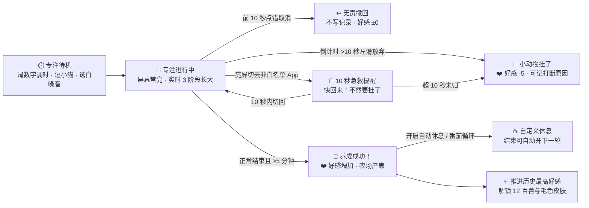

### 2) 10 只好感伙伴的成长曲线

每完成一轮有效计时专注（非手动补录、正常结束且满 5 分钟），每满 5 分钟 **`❤️ 好感 +1`**（单局上限 `+36`，每日上限 `+120`），每满 25 分钟至少在农场多一只小动物。就算偶尔中途放弃扣了 5 点好感，解锁只看**历史最高好感**，已经陪伴你的伙伴永远不会再被锁回去：

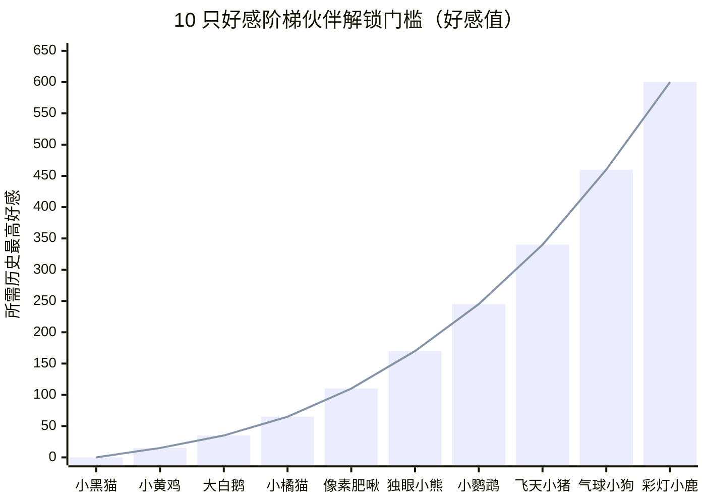

> 此外还有 **2 只隐藏成就伙伴**：连续有效专注满 **7 天** 解锁 **天使黑猫**，累计养大满 **50 只**动物解锁 **小黑龙**！

<details>
<summary><b>🐾 点此展开：全部 12 只百兽成长形态与多毛色皮肤一览</b></summary>

| # | 伙伴名称 | 解锁条件 | 3 阶段成长形态 |
| :-: | --- | --- | --- |
| 1 | **小黑猫** | 🎁 开局默认自带 | 黑毛球 → 短尾奶猫 → 圆眼翘尾猫 |
| 2 | **小黄鸡** | ❤️ 好感达到 `15` | 裂缝蛋 → 呆毛绒球 → 红冠小鸡 |
| 3 | **大白鹅** | ❤️ 好感达到 `35` | 白绒团 → 短颈小鹅 → 红围巾大白鹅 |
| 4 | **小橘猫** | ❤️ 好感达到 `65` | 橘纹球 → 舔爪橘崽 → 白肚圆胖橘猫 |
| 5 | **像素肥啾** | ❤️ 好感达到 `110` | 像素蛋 → 像素雏鸟 → 8-bit 复古紫肥啾 |
| 6 | **独眼小熊** | ❤️ 好感达到 `170` | 黑耳团 → 坐姿熊崽 → 红星眼罩酷黑熊 |
| 7 | **小太阳鹦鹉** | ❤️ 好感达到 `245` | 绿羽团 → 呆毛雏鸟 → 红脸蛋小太阳鹦鹉 |
| 8 | **飞天小猪** | ❤️ 好感达到 `340` | 黑猪鼻团 → 短腿黑猪 → 灰翅膀飞天猪 |
| 9 | **气球小狗** | ❤️ 好感达到 `460` | 充气粉球 → 双节气球 → 粉黄扭扭气球狗 |
| 10 | **彩灯小鹿** | ❤️ 好感达到 `600` | 红鼻鹿崽 → 短角小鹿 → 鹿角缠满彩灯鹿 |
| 11 | **天使黑猫** | 🏅 连续有效专注满 **7 天** | 闪电奶猫 → 小芽翅猫 → 紫翅彩虹光环黑猫 |
| 12 | **小黑龙** | 🏅 累计养大满 **50 只**动物 | 金元宝龙蛋 → 红角幼龙 → 东方祥云小黑龙 |

- 🐈‍⬛ **小黑猫多毛色**：`煤球纯黑`（默认） · `奶牛黑白斑`（养大 10 只解锁） · `暹罗重点色`（养大 30 只解锁）
- 🐥 **小黄鸡多毛色**：`嫩芽黄`（默认） · `栗子棕`（养大 10 只解锁） · `雪团白`（养大 30 只解锁）

</details>

<details>
<summary><b>📐 点此展开：计时与统计的细则约定</b></summary>

- **暂停不糊弄时长**：暂停的时间不会算进实际专注时长；提前结束也会诚实保留已经投入的那段时间。
- **一次只做一件事**：同一时间只能有一条未结束的专注、休息或锁机；普通专注下锁屏或切去查资料不会中断计时。
- **意外重启兜底**：同次开机里误退重新打开会自动接上计时；如果手机重启，则按 `中断` 保留最后保存下来的时长。
- **待办删改不毁历史**：修改或删除某个 `子待办`，过去的专注记录和累计统计依然完整保留。
- **跨午夜与补录规则**：跨过零点的专注会把实际时长精确切分到两天，专注次数归开始当天；休息不计入专注统计；`手动补录` 仅计入时间轴与时长分布，不刷好感、不产动物、不计专注次数。

</details>

---

<a id="protection"></a>

## 🛡️ 三档防分心：从“零权限轻提醒”到“原生强约束”

不是每个人都想刚装一个 App 就去系统设置里开一堆高阶权限。所以我们把防分心做成三档，按自己的需要选就行，**开屏零索权，用到哪档再引导哪档**：

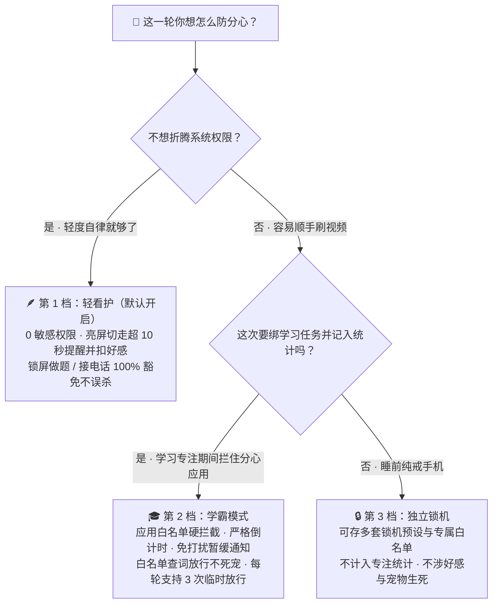

| 档位 | 所需权限 | 特点与贴心细节 |
| --- | --- | --- |
| 🪶 **轻看护**（默认开） | **0 敏感权限**（通知可选） | 装完即用。按电源键熄屏做题、接打电话、跳去查白名单软件统统豁免；只有亮屏切走且超过 10 秒不回来才会判定挂掉。 |
| 🎓 **学霸模式** | 日常限制只需「使用情况 + 悬浮窗」（重启不掉权）；高阶防退出按需开无障碍 / 勿扰 / 通知监听 | 切入非白名单应用时由黑白原生遮罩直接拦回；专注中支持暂缓外部通知、结束后再原样释放（绝不偷存消息正文）；保活向导按手机品牌直达设置页，没有焦虑红标。 |
| 🔒 **独立锁机** | 复用学霸引擎（可选防误卸载 / 重启续锁） | 适合睡前或午休戒手机，严格与专注统计隔离（遵循 [ADR 0004](docs/adr/0004-native-focus-control-boundary.md)）。 |

> [!IMPORTANT]
> **我们始终如实告知 Android 的真实系统边界**
> - 我们**绝不吹嘘**“系统保证绝对无法强停或卸载”。Android 框架和各手机厂商（OPPO / 小米 / vivo / 华为 / 荣耀 / 三星等）的安全中心会对最近任务隐藏、桌面图标隐藏、无障碍连接和后台保活施加不同限制；实际支持情况请以应用内 **我的 → 高级保护与诊断** 实测为准，完整实测记录与已知限制公开在 [逐项验收报告](docs/focus-control-final-acceptance.md)。
> - **随时留有 2 步安全出口**：无论处于多严格的学霸专注还是锁机中，通过专注页右上角 `⋯`、原生遮罩底部入口或常驻通知，都能在 **2 步内**直达紧急拨号（`/emergency`）、离线帮助（`/help`）和一键故障恢复（`/recovery`）。

---

<a id="architecture"></a>

## 🏗️ 技术架构与本地开发

> 下面这部分面向开发者和想自己编译源码的朋友。

### 🏛️ 架构一览：前端负责界面，原生 Java + SQLite 掌握唯一事实源

计时准确度、防分心遮罩、白噪音锁屏续播和应用内更新全部由 **Android Java 原生层**直接负责，Vue 前端只做轻量交互展示，绝不跑两套互相打架的计时器：

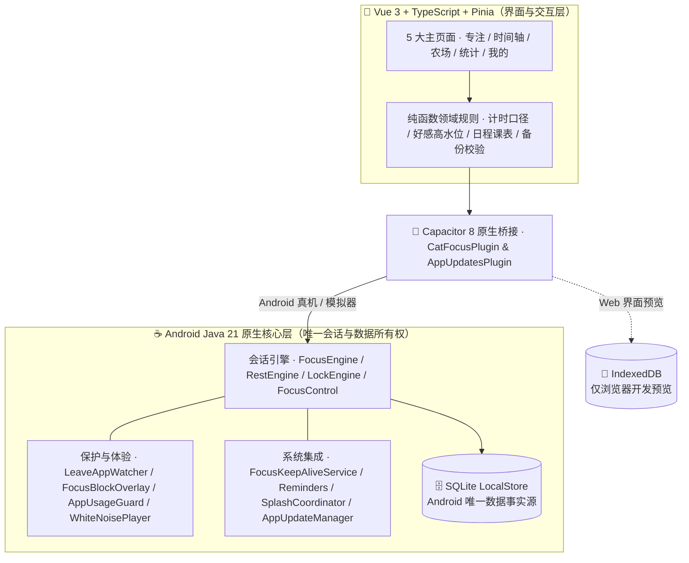

| 层级 | 技术栈 | 说明 |
| --- | --- | --- |
| 🎨 **前端与交互** | Vue `3.5` · TypeScript `5.9` · Vite `8` · Pinia `4.1` · Vue Router `5.5` | 界面、状态镜像、五栏手势与单层弹窗约束 |
| 📊 **视觉与图表** | Apache ECharts `6.1` · Lucide Icons · 离线 `Nunito` 可变字体 | 统计图表、365 热力图与等宽圆润计时数字 |
| 🔌 **跨端桥接** | Capacitor `8.6` | Android 打包与前端/原生双向插件通信 |
| ☕ **安卓原生层** | Java `21` · Android SDK `36`（`minSdk 24`）· Gradle `8.14.7` | 计时互斥引擎、三档防分心、白噪音、SAF 导出与应用更新 |
| 🗄️ **本地存储** | SQLite（Android）/ IndexedDB（Web 预览） | 两端数据相互独立；云端 Java / Spring Boot / MySQL 预留给后续同步阶段 |
| ✅ **自动化测试** | Vitest `5.1` · Android JUnit · Android 仪器测试 | 36 套宿主单测 + 6 套 UX E2E + 17 套 Android JVM 单测 + 29 套仪器测试 |

### 🛠️ 快速运行与编译 APK

**验证环境**：Node.js `24` / npm `11` · JDK `21`（配置 `JAVA_HOME`）· Android SDK `36` / Build Tools `35` · 内置 Gradle Wrapper `8.14.7`。

```bash
# 1. 拉取代码并启动浏览器预览（独立 IndexedDB，适合快速调界面）
git clone https://github.com/cjx-bc/kitten-focus.git
cd kitten-focus
npm ci
npm run dev -- --port 5188
```

```powershell
# 2. 编译 Android Debug APK（需先在 android/local.properties 配置本机 sdk.dir）
npm.cmd run build
npx.cmd cap sync android
cd android
.\gradlew.bat :app:assembleDebug --console=plain
# 产物输出：android/app/build/outputs/apk/debug/app-debug.apk
```

```powershell
# 3. 连接 USB 真机开发调试：一键编译、覆盖安装并自动恢复调试权限
npm.cmd run android:dev-install

# 跳过构建直接安装并授权 / 仅重新下发权限
npm.cmd run android:install
npm.cmd run android:grant
```

```powershell
# 4. 运行自动化测试套件
npm.cmd test                                            # 宿主单元测试 (Vitest)
npx.cmd vitest run --config vitest.e2e.config.ts        # 浏览器交互与 UX 预算门禁 E2E
cd android
.\gradlew.bat :app:testDebugUnitTest --console=plain    # Android JVM 单元测试
.\gradlew.bat :app:connectedDebugAndroidTest --console=plain  # 仪器测试（请用专用测试设备）
```

<details>
<summary><b>⚙️ 展开查看：OPPO / ColorOS 真机一键授权前置设置 & 当前测试覆盖情况</b></summary>

#### OPPO / ColorOS 一次性前置设置
- 首次使用 `android:dev-install` 前，请在手机「设置 → 系统设置（或其他设置）→ 开发者选项」中打开 **USB 调试**，并滑到底部打开 **「禁止权限监控」**（否则系统会拦截 `WRITE_SECURE_SETTINGS` 等 ADB 授权）。
- 多设备同时连接时，可通过 `--serial <序列号>` 或 `$env:ANDROID_SERIAL` 指定目标设备；Windows PowerShell 若拦截 `npm.ps1` 请使用 `npm.cmd` / `npx.cmd`。

#### v0.3.1 实测覆盖与诚实边界
- ✅ **36 个宿主测试文件 / 270 项单元测试**通过；**6 个 E2E 文件 / 38 项浏览器与 UX 门禁检查**通过。
- ✅ **17 个 Android JVM 测试文件 / 82 项单元测试**通过；仪器测试编译及 APK 签名/哈希校验通过。
- ✅ **Android 16（API 36）模拟器专项验证**通过（SAF 导出、白噪音面板与前台服务升级、即时通知与 10 秒内撤回、365 热力图与锁竞争检查），以及此前版本在 OPPO Find X7 Ultra 上的实机覆盖升级验证。
- ⚠️ 跨品牌物理真机的长时间锁屏、真实重启、省电策略矩阵与自动化全量真机仪器回归仍在持续补充，详情见 [v0.3.1 发布说明](releases/release-0.3.1.md) 与 [历史验证记录](docs/verification.md)。

</details>

<details>
<summary><b>📂 展开查看：仓库目录结构</b></summary>

```text
kitten-focus/
├── src/
│   ├── views/              # 专注、时间轴/日程/课表、一周农场、统计、我的、待办、锁机、安全中心
│   ├── components/         # 单层弹窗、学霸模式配置、百兽矢量插画、白名单编辑器、图表与图标
│   ├── domain/             # 计时规则、好感与农场推导、手动补录、日程课表、统计与备份校验
│   ├── stores/             # Pinia 状态与更新管理
│   ├── platform/           # Capacitor 原生桥接、白噪音、PNG 导出与 Web 预览存储
│   └── navigation/         # 主入口守卫与五栏滑动切换
├── android/                # Android 工程、Java 原生核心引擎、JVM 单测与仪器测试
├── public/                 # 5 路离线白噪音 (.wav)、Nunito 离线字体与图标素材
├── tests/                  # Vitest 业务逻辑单元测试与浏览器 UX 门禁 E2E
├── scripts/                # 真机一键安装授权、UI 烟雾测试与发布校验脚本
├── deploy/                 # 官方下载页 (focus.linma.asia) 与 HTTPS 更新清单配置
├── releases/               # 版本发布说明与校验清单（APK 二进制托管于 GitHub Releases）
├── docs/                   # 交互规范、品牌规范、v2 方案、架构决策 (ADR)、验收报告与 README 截图
├── DESIGN.md / PRODUCT.md / GLOSSARY.md
```

</details>

---

<a id="roadmap"></a>

## 🗺️ 迭代路线图

### ✅ 已经上线（v0.3.x）
- [x] 专注待机首屏、滑动调时、3 阶段实时孵育、10 秒无责撤回与左滑放弃
- [x] 12 只百兽双轨图鉴、多款毛色皮肤、自然周农场与周打卡 PNG 导出
- [x] 时间轴、复盘小结、防刷分手动补录、一周 24h 四色图，完整保留个人日程与多学期课表
- [x] 日/周/月/年/累计统计、时长与次数切换、动物头趋势柱与 365 天年度热力图
- [x] 5 路离线白噪音锁屏续播与拔耳机自动暂停、自定义休息与番茄循环、锁屏通知操控
- [x] 轻看护 / 学霸模式 / 独立锁机三档防分心与四维保活向导
- [x] 本地 JSON 备份恢复与安静不打扰的应用内更新

### 🚧 正在规划（尚未在当前版本实现）
- [ ] 🏅 **成就徽章物理堆**：20 枚贴纸圆章，带 2D 物理重力掉落堆叠互动（P1）
- [ ] 🌙 **纯黑深色模式**：浅色 / 纯黑护眼深色 / 跟随系统切换，原生遮罩同步变色（P1）
- [ ] 🪟 **后台悬浮计时小窗**：普通专注切到后台时的迷你动物倒计时胶囊（P1）
- [ ] 🧩 **3 款桌面小组件 & 小猫壁纸**：宠物桌面时钟 2×2、今日专注 2×2、月热力与本周养宠 4×2 及高清锁屏壁纸导出（P1）
- [ ] 🤖 **AI 专注助手**：聊天安排日程、拍照识别课表与专注复盘辅助（远期）
- [ ] ☁️ **账号与云同步**：基于 Java / Spring Boot / MySQL 的跨设备备份与同步（远期）

---

## 📚 项目文档与致谢

| 分类 | 文档入口 |
| --- | --- |
| 🎨 **产品与设计** | [产品定位 PRODUCT.md](PRODUCT.md) · [设计系统 DESIGN.md](DESIGN.md) · [交互规范 ux-spec.md](docs/ux-spec.md) · [品牌基准 brand-spec.md](docs/brand-spec.md) · [业务术语 GLOSSARY.md](GLOSSARY.md) |
| 🐾 **功能方案** | [v2 陪伴与养成方案](docs/cat-companion-plan.md) · [第一版产品规格](docs/v1-spec.md) · [需求访谈记录](docs/requirements.md) · [休息规则](docs/focus-rest.md) |
| 🏗️ **架构与发布** | [架构决策 docs/adr/](docs/adr/)（ADR 0001–0005） · [技术选型调研](docs/tech-stack-research.md) · [应用内更新](docs/app-updates.md) · [域名分发说明](docs/domain-distribution.md) |
| 🧪 **验收与声明** | [专注保护逐项验收报告](docs/focus-control-final-acceptance.md) · [历史验证记录](docs/verification.md) · [界面参考说明](docs/references/README.md) · [第三方资源声明](THIRD_PARTY_NOTICES.md) |

- 🔤 离线数字字体 **Nunito**：遵循 [SIL Open Font License 1.1](public/fonts/OFL.txt)。
- ✏️ 应用内线性图标 **Lucide**：遵循 [ISC License](licenses/lucide-ISC.txt)。
- 📦 其余第三方依赖与专注保护独立实现说明详见 [THIRD_PARTY_NOTICES.md](THIRD_PARTY_NOTICES.md)。

<div align="center">

<br />

<sub>🐱 认真一点，也轻松一点 · 如果觉得顺手，欢迎给仓库点个 ⭐ Star · <b>小猫专注 Kitten Focus</b></sub>

</div>
