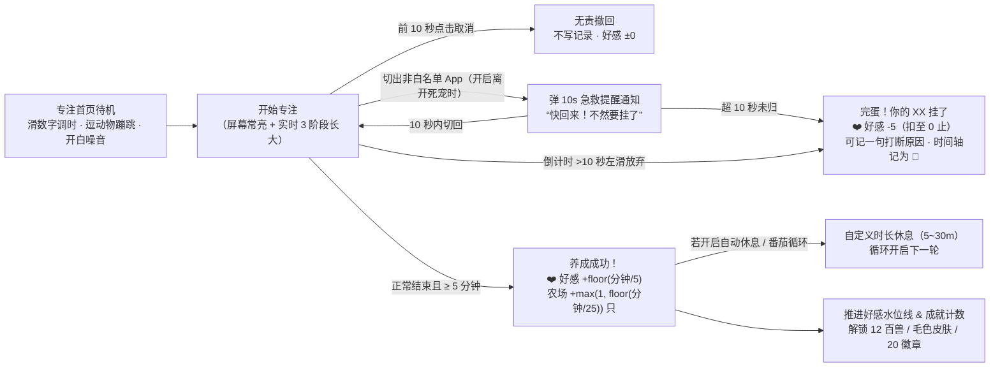

# 小猫专注 v2：《小鸡专注》1:1 神形兼备全复刻方案

| 项 | 内容 |
| --- | --- |
| 状态 | **confirmed-baseline（二轮严查定稿版）** |
| 日期 | 2026-11-27 |
| 适用版本 | 0.3.x 起（当前线上 0.2.16） |
| 对标基准 | iOS《小鸡专注》（App Store ID `1627691759` v4.8.2）及仓库全套参考图 [official-01..10.jpg](references/chickfocus/) |
| 核心原则 | **100% 复刻《小鸡专注》全部界面流、心理博弈机制与微交互手感**；现有「待办管理」「日程/课表」「学霸模式/锁机」代码零删除、无损收纳兼容 |
| 本文不做的事 | 本文为实施规格基线，不直接改代码；上游文档与自动化门禁同步清单见第 12 节（P0-1 执行） |

**目录**：1 复刻全景对照表（10 图 + 真机手感全覆盖） · 2 顶层导航与首屏重塑 · 3 核心养成、防分心死宠与好感度系统 · 4 12 只百兽图鉴（好感+成就双轨 & 多配色皮肤） · 5 分模块详细规格（M1–M8） · 6 原生锁机/权限融合与设计系统 · 7 美术、音频与深色模式规范 · 8 技术架构与数据模型 · 9 测试与 UX 门禁对齐 · 10 里程碑与 Issue 拆分 · 11 风险与应对 · 12 上游文档与门禁修订清单

---

## 1. 《小鸡专注》10 张原图 + 真机隐藏手感 1:1 复刻总表

| 对照维度 | 《小鸡专注》原版真机全部细节 | 本方案复刻实现 | 阶段 |
| --- | --- | --- | --- |
| **[official-01.jpg](references/chickfocus/official-01.jpg)**<br>专注首屏与把玩手感 | • 打开 App 首屏即专注页；左上选标签 `[数学测试 ›]`<br>• 右上 `🖼 悬浮窗` + `🎵 白噪音`<br>• **滑动时间数字直接无级调时长**（配刻度轻震动）<br>• **点小动物原地蹦跳互动**（换宠走独立入口不误弹窗）<br>• 专注中**屏幕常亮** + **随进度实时 3 阶段长大**<br>• **10秒后悔期** + **`« 左滑放弃`** | **100% 复刻**：根路由 `/` 直达专注首页；滑动数字 `5~180m` 丝滑调时（滑到底切正计时）；点动物 Q 弹蹦跳彩蛋、点脚下胶囊换宠；专注默认开启 `FLAG_KEEP_SCREEN_ON` 屏幕常亮；实时 3 阶长大；10 秒内无责取消，10 秒后 `« 左滑放弃`；内置离线白噪音 | P0（悬浮窗放 P1） |
| **[official-02.jpg](references/chickfocus/official-02.jpg)**<br>放弃与切屏挂掉机制 | • **左滑放弃**或**切出非白名单应用超 10 秒未归** → 小动物直接挂掉！<br>• 倒吊插画 + “完蛋！你的鸡挂了” + `❤️ 好感 -5`<br>• 可顺手记录打断/放弃原因 | **100% 复刻**：同时支持主动左滑放弃与 **0 权限「离开应用超 10s 死宠」看护开关**（锁屏熄屏/通话/白名单豁免，切走立即发 10s 急救提醒）；失败页支持一键勾选或手写打断原因 | P0（M1/M2） |
| **[official-03.jpg](references/chickfocus/official-03.jpg)**<br>百兽图鉴与多配色 | • 攒好感与达成成就解锁小鸡、黑猫、像素鸡、天使猫、龙、气球狗等<br>• v4.8.2 初代角色拥有「栗子」等多配色皮肤 | **100% 复刻**：黑猫开局 + 12 只混搭百兽（**10 只好感阶梯解锁 + 2 只隐藏神兽成就解锁**）；小黑猫与小黄鸡各配 **3 款毛色皮肤**（含致敬原版的「栗子色」）；支持指定或随机出场 | P0（M3） |
| **[official-04.jpg](references/chickfocus/official-04.jpg)**<br>白名单拦截页 | • “专注中禁止使用”极简拦截页 | **完整具备且更强**：既有 0 权限离开 10s 死宠轻监督，又有 Android 原生学霸白名单 0ms 遮挡拦回 | 已有 + 联动 |
| **[official-05.jpg](references/chickfocus/official-05.jpg)**<br>一周农场 | • 木牌“一周农场” + 小屋本周只数 `128` + 百兽散步互动 | **100% 复刻**：底栏第 3 栏「一周农场」，点击散步动物蹦跳并显示对应专注记录，支持切周回看历史周农场 | P0（M4） |
| **[official-06.jpg](references/chickfocus/official-06.jpg)**<br>成就徽章堆 | • “解锁成就徽章 堆成一堆”（物理重力掉落堆底） | **100% 复刻**：20 枚贴纸圆章，2D 圆盘刚体碰撞掉落堆底，点按查看详情，其中 2 枚联动解锁天使黑猫与小黑龙 | P1（M7） |
| **[official-07.jpg](references/chickfocus/official-07.jpg)**<br>时间轴、补录与周图 | • 日期旁 `[+]` 手动补录<br>• 成功卡印动物、橙红失败卡印小幽灵 `👻`，右侧 `✎` 写复盘/失败原因<br>• **一周 00–23h 四色分布打卡图** | **100% 复刻**：底栏第 2 栏默认「时间轴」，完整复刻成功/失败记录图标、小结编辑、`[+]` 补录（不刷好感）、以及一键导出「一周 24h 四色分布图」；顶栏保留入口切回原有日程/课表 | P0（M5） |
| **[official-08.jpg](references/chickfocus/official-08.jpg)**<br>多维统计 | • `按时长 ⇄`、放弃次数、均值线动物头柱、365 热力图 | **100% 复刻**：补齐放弃次数、时长/次数切换、达标红冠黑头/未达标浅灰头趋势柱、滑选式 365 热力图 | P0（M6） |
| **[official-09.jpg](references/chickfocus/official-09.jpg)**<br>锁屏控制与壁纸 | • 锁屏直接暂停/结束 + 送小猫壁纸 + 番茄自动休息循环 | **100% 复刻**：常驻通知补齐原生 `暂停/继续` 与 `结束` 按钮；支持**自定义休息时长（5/10/15/20m）+ 自动休息 + 番茄循环**；内置 4 款小猫壁纸导出 | P0 通知与番茄流 / P1 壁纸 |
| **[official-10.jpg](references/chickfocus/official-10.jpg)**<br>三款小组件与深色 | • **宠物桌面时钟 2×2**、今日专注 2×2、月热力/本周养宠 4×2<br>• 纯黑深色模式 | **100% 复刻**：3 款桌面小组件全覆盖（含左上角高人气日常宠物时钟组件）+ 全局浅色/纯黑深色/跟随系统切换 | P1（M8） |

---

## 2. 顶层导航与首屏重塑（零损兼容现有功能）

```text
[ 专注 (/focus) ]  ｜  [ 时间轴 (/calendar) ]  ｜  [ 农场 (/cat) ]  ｜  [ 统计 (/statistics) ]  ｜  [ 我的 (/settings) ]
```

1. **打开 App 首屏直达 `/focus`（专注待机首页）**：第一眼就是屏幕中央的小动物 + `25:00` 大数字 + 底部 `开始专注` 主按钮，1 步直接进入心流。
2. **原有「待办列表（`TasksView`）」无损收纳**：点击专注页左上角 `[🏷 数学测试 ›]` 弹出单 `<Sheet>` 秒切待办/自由专注，右上附 `管理全部待办 ›` 进入完整 `/tasks`。
3. **原有「日程与课表」无损收纳**：`/calendar` 默认打开复刻版 **「时间轴」**，顶栏右侧保留 `[日程/课表]` 切换入口，原有课表数据与功能一行不删。

---

## 3. 核心养成、防分心死宠与好感度系统

### 3.1 完整游玩状态机



### 3.2 精确数值与防分心判定表

| 规则项 | 精确口径 | 说明 |
| --- | --- | --- |
| **10 秒无责后悔期** | `elapsedMs < 10_000` | 前 10 秒取消直接清空会话、不写数据库、不扣好感 |
| **0 权限「离开应用死宠」看护** | `preferences.leaveAppFail`（默认 `true`，可关）：专注运行中（非暂停）触发 `MainActivity.onStop` 且**屏幕亮着未锁屏**（`isInteractive && !isKeyguardLocked`）、**非通话中**、**非已放行白名单应用** | 立即弹高优提醒通知并倒数 `10s`；10 秒内回前台则安全继续；超 10 秒未归自动判定 `early` 失败（`failReason: 'left_app'`），动物挂掉 `-5 好感`！（注：若同时开启重度学霸强遮挡，则由遮罩 0ms 拦回优先） |
| **实时 3 阶段长大** | 倒计时进度 `0–33%`（破壳/绒团）→ `33–75%`（幼崽）→ `75–100%`（准成体）；正计时按 `0–8m / 8–20m / 20m+` | 搭配默认开启的 `FLAG_KEEP_SCREEN_ON` 屏幕常亮，放书桌支架全程可见成长 |
| **有效养成与好感产出** | `source !== 'manual' && status === 'completed' && durationMs >= 5 * 60_000` | 每满 5 分钟 **`❤️ +1`**（25m = **`+5`**，单次封顶 `+36`，每日上限 `+120`）；农场产崽 `max(1, floor(min/25))` 只 |
| **放弃与超时未归惩罚** | 倒计时 `elapsedMs >= 10_000` 且 `status === 'early'` → **`❤️ 好感 -5`**（最低扣至 `0`） | 已专注时长照常计入总时长，时间轴显示橙红小幽灵 `👻` 卡并支持记录打断原因 |
| **高水位永不回锁** | `peakAffection = max(peakAffection, affection)` | 达到 `unlockAt` 即永久解锁；扣好感不锁回已得宠物，但需补回差额才能推进下一只 |
| **手动补录防刷隔离** | `source === 'manual'` | 计入时间轴浅灰块与统计时长，**好感 `±0`、产崽 `0`、不计入成就与毛色次数** |
| **老用户正收益追溯** | 0.2.x 存量升级用户设 `retroCutoffAt = now`（新装为 `null`） | 升级前有效专注折算初始好感与小黑猫养成次数，历史放弃不倒扣 |

---

## 4. 首批 12 只百兽图鉴（10 好感阶梯 + 2 成就神兽 + 多配色皮肤）

### 4.1 12 只百兽完整解锁表

| 序号 | `animalId` | 名称 | 解锁途径与条件 | 3 阶段成长外观 | 挂了翻车文案 |
| --- | --- | --- | --- | --- | --- |
| 1 | `black-cat` | 小黑猫 | **开局默认**（支持 3 款毛色） | 黑毛球 → 短尾奶猫 → 圆眼翘尾猫 | “完蛋！你的小黑猫挂了” |
| 2 | `yellow-chick` | 小黄鸡 | **`❤️ 15` 好感**（~1.25h，支持 3 款配色） | 裂缝蛋 → 呆毛绒球 → 红冠小鸡 | “完蛋！你的小黄鸡挂了” |
| 3 | `white-goose` | 大白鹅 | **`❤️ 35` 好感**（~3h） | 白绒团 → 短颈小鹅 → 红围巾大白鹅 | “完蛋！你的大白鹅挂了” |
| 4 | `orange-cat` | 小橘猫 | **`❤️ 65` 好感**（~5.5h） | 橘纹球 → 舔爪橘崽 → 白肚圆胖橘猫 | “完蛋！你的小橘猫挂了” |
| 5 | `pixel-bird` | 像素肥啾 | **`❤️ 110` 好感**（~9h） | 像素蛋 → 像素雏鸟 → 8-bit 复古紫肥啾 | “完蛋！你的像素肥啾挂了” |
| 6 | `patch-bear` | 独眼小熊 | **`❤️ 170` 好感**（~14h） | 黑耳团 → 坐姿熊崽 → 红星眼罩酷黑熊 | “完蛋！你的独眼小熊挂了” |
| 7 | `green-parrot` | 小太阳鹦鹉 | **`❤️ 245` 好感**（~20h，致敬 4.8.2） | 绿羽团 → 呆毛雏鸟 → 红脸蛋小太阳鹦鹉 | “完蛋！你的小鹦鹉挂了” |
| 8 | `flying-pig` | 飞天小猪 | **`❤️ 340` 好感**（~28h） | 黑猪鼻团 → 短腿黑猪 → 灰翅膀飞天猪 | “完蛋！你的飞天小猪挂了” |
| 9 | `balloon-dog` | 气球小狗 | **`❤️ 460` 好感**（~38h） | 充气粉球 → 双节气球 → 粉黄扭扭气球狗 | “完蛋！你的气球小狗漏气挂了” |
| 10 | `light-deer` | 彩灯小鹿 | **`❤️ 600` 好感**（~50h） | 红鼻鹿崽 → 短角小鹿 → 鹿角缠满彩灯鹿 | “完蛋！你的彩灯小鹿挂了” |
| 11 | `angel-cat` | **天使黑猫** | **🏅 成就解锁**：连续专注满 **7 天** | 闪电奶猫 → 小芽翅猫 → 紫翅彩虹光环黑猫 | “完蛋！你的天使黑猫挂了” |
| 12 | `black-dragon` | **小黑龙** | **🏅 成就解锁**：累计养大满 **50 只**动物 | 金元宝龙蛋 → 红角幼龙 → 东方祥云小黑龙 | “完蛋！你的小黑龙挂了” |

### 4.2 初代双主角多毛色皮肤（CSS 变量零体积换色）

- **小黑猫（`black-cat`）**：`煤球纯黑（默认）` · `奶牛黑白斑（累计养出 10 只小黑猫解锁）` · `暹罗重点色（累计 30 只解锁）`。
- **小黄鸡（`yellow-chick`）**：`嫩芽黄（默认）` · `栗子棕（累计养出 10 只小黄鸡解锁，致敬原版 4.8.2 新配色）` · `雪团白（累计 30 只解锁）`。

---

## 5. 分模块详细规格（M1–M8）

### M1 专注首页：滑动调时、点宠蹦跳、屏幕常亮、离开死宠与白噪音（P0）

1. **无弹窗丝滑待机操作**：
   - **滑动数字调时长**：手指在 `25:00` 区域上下或左右拖动，每 `18px` 步进 `5 分钟`（范围 `5–180 分钟`；向最小端再滑一步切为 `00:00 正计时`），每次跨刻度触发 `8ms` 轻触感反馈；下方保留极简文字提示（如 `倒计时 · 上下滑动调时长`，无障碍聚焦或点击可展开快捷分钟条 `15 / 25 / 45 / 60`）。
   - **点小动物蹦跳彩蛋 vs 独立换宠胶囊**：
     - 直接点击小动物插画：播放 `320ms` 弹性蹦跳动画 + 头顶浮现随机短气泡（如 `"今天也要加油！"` / `"咕咕～"` / `"喵！"`）；
     - 点击动物脚下胶囊 `[小黑猫 · 换伙伴 ›]`：打开单 `<Sheet>` 图鉴（支持选动物、切解锁配色、或开启 `🎲 随机出场`）。
   - **顶栏控件**：左上 `[🏷 {待办名 / 自由专注} ›]` 选待办；右上 `[☀ 常亮]`（或收进快捷项，默认开启屏幕常亮）、`[🖼 悬浮窗]`、`[🎵 白噪音]`。
2. **运行态体验**：
   - **屏幕常亮**：运行态与休息态默认激活原生 `FLAG_KEEP_SCREEN_ON`（可在设置关闭）。
   - **10 秒后悔期 + `« 左滑放弃`**：`0–10s` 显示无责 `取消`；`>10s` 显示灰底滑轨 `« 左滑放弃 [←]` + 旁置 `‖ 暂停` 按钮（严格倒计时下隐藏放弃与暂停）。
   - **0 权限离开应用 10s 死宠看护**：见 3.2 节，切出非白名单应用立即发通知倒数 10 秒，超时未归自动判定挂掉。
   - **离线白噪音（`WhiteNoisePlayer.java` · 锁屏保活与图书馆防社死）**：内置 5 段无缝循环环境音并配 **独立音量滑杆（`0–100%`，默认 `60%`）**，使用 `AUDIOFOCUS_GAIN_TRANSIENT_MAY_DUCK` 不压过网课人声；`FocusKeepAliveService` 叠加 `mediaPlayback` 类型防止 Android 14+ 锁屏 3 分钟断音；监听 `ACTION_AUDIO_BECOMING_NOISY` 在**蓝牙断连或拔耳机瞬间自动暂停外放**。
   - **锁屏通知快捷控制**：常驻通知挂载 `暂停/继续`、`结束` 按钮，无需解锁即可操作。

### M2 结算页与番茄循环流（P0）

1. **成功养大页**：成体插画 + `❤️ 好感 +{gain} · 农场 +{litter} 只` + 内联 `写一句小结 ✎` + 主按钮 `休息 {restMinutes} 分钟`（支持 `5 / 10 / 15 / 20` 分钟配置）。
2. **失败“挂了”页**：倒吊/翻车插画 + `完蛋！你的{动物名}挂了`（若因切出超时挂掉，副标提示 `离开专注太久，没能救回来`） + `❤️ 好感 -5` + **内联 `记一句打断原因 ✎`**（附 `回消息 / 刷视频 / 临时有事 / 走神了` 快捷词）+ 主按钮 `返回首页` + 次按钮 `↻ 重新开始`。
3. **自动休息与番茄循环**：
   - 若开启 `preferences.autoRest`：倒计时正常完成后自动展示 1.5s 养成庆祝微提示并无缝切入 `/rest` 休息倒计时；
   - 若同时开启 `preferences.pomodoroLoop`：休息倒计时归零后自动按上轮待办与时长开启新一轮专注（振动/铃声轻提醒）。

### M3 好感与成就双轨图鉴（P0）

- 单 `<Sheet>` 展示当前 `❤️ 好感`、`🎲 随机出场` 卡片与 12 只百兽网格；已解锁角色支持点选切换毛色圆点；成就神兽未解锁时显示成就进度（如 `连续专注 4/7 天`）。

### M4 一周农场（重写 `CatView.vue`，P0）

- 1:1 复刻 `official-05.jpg`：左上 `‹ 一周农场 ›` 切历史周、右上小屋 + 本周真实养成总只数角标、草坡散步群宠（同屏上限 36 只等比抽样）；点击任意小动物原地蹦跳并在底栏显示对应记录详情；右上菜单支持 **一键保存「本周农场打卡图」**（Canvas 合成当周时长、养成只数与散步百兽 PNG）。

### M5 时间轴、`[+]` 手动补录与一周 24h 四色分布图（改 `CalendarView.vue`，P0）

- 1:1 复刻 `official-07.jpg`：默认展示时间轴（顶栏可切回原有日程/课表）；成功卡印动物、失败卡橙红描边印小幽灵 `👻`（展示打断原因或复盘小结）；日期旁 `[+]` 手动补录（`source: 'manual'` 不刷好感）；一键生成并导出 **「一周 00:00–23:00 四色分布打卡图」**（黑=专注 / 斜纹=暂停 / 橙红=失败 / 浅灰=添加）。

### M6 统计页四件套（改 `StatisticsView.vue`，P0）

- 1:1 复刻 `official-08.jpg`：概览新增 `放弃次数`；趋势与分布支持 `按时长 ⇄ 按次数`；柱状图升级为均值线 + 达标红冠黑头/未达标浅灰趴头；年视图补齐单容器滑选式 `365` 热力图。

### M7 成就徽章物理“堆成一堆”（P1，复刻 `official-06.jpg`）

20 枚贴纸圆章全部由 `FocusRecord[]`（过滤 `source !== 'manual'`）与 `peakAffection` 纯函数推导达成时间戳，打开徽章页时已解锁圆章以 2D 刚体碰撞从顶部掉落堆底：

| 编号 | 徽章名 | 解锁条件 | 联动奖励 / 贴纸视觉 |
| --- | --- | --- | --- |
| `BDG-01` | 破壳而出 | 完成第 1 次有效专注 | 黑底破壳小鸡圆章 |
| `BDG-02` | 十拿九稳 | 累计完成 10 次有效专注 | 黑底 `10` 星芒八角章 |
| `BDG-03` | 小农场主 | 累计养出 50 只小动物 | **同步解锁隐藏神兽「小黑龙」** |
| `BDG-04` | 百兽热闹 | 累计养出 200 只小动物 | 黑白群宠剪影圆章 |
| `BDG-05` | 初露锋芒 | 累计实际专注满 10 小时 | 纸飞机黑底圆章 |
| `BDG-06` | 渐入佳境 | 累计实际专注满 50 小时 | 羽毛笔红心圆章 |
| `BDG-07` | 百炼成钢 | 累计实际专注满 100 小时 | 学士帽八角章 |
| `BDG-08` | 长期主义 | 累计实际专注满 300 小时 | 皇冠黑金圆章 |
| `BDG-09` | 传世专注 | 累计实际专注满 500 小时 | 奖杯星光圆章 |
| `BDG-10` | 三日不辍 | 连续 3 天有有效专注 | 三叶嫩芽圆章 |
| `BDG-11` | 一周全勤 | 连续 7 天有有效专注 | **同步解锁隐藏神兽「天使黑猫」** |
| `BDG-12` | 半月笃行 | 连续 14 天有有效专注 | 红苹果小鹿角圆章 |
| `BDG-13` | 满月自律 | 连续 30 天有有效专注 | 满月黑猫剪影章 |
| `BDG-14` | 沉浸两小时 | 单日有效专注满 2 小时 | 咖啡杯圆章 |
| `BDG-15` | 深度学习 | 单日有效专注满 4 小时 | 火焰小黑猫章 |
| `BDG-16` | 铁人八小时 | 单日有效专注满 8 小时 | 闪电护目镜章 |
| `BDG-17` | 早起鸟儿 | 在 `05:00–07:30` 开启并完成 5 次有效专注 | 朝阳小黄鸡章 |
| `BDG-18` | 夜行黑猫 | 在 `21:30–23:59` 开启并完成 5 次有效专注 | 弯月猫眼章 |
| `BDG-19` | 吾日三省 | 累计写下 10 条专注复盘小结 | 铅笔手帐八角章 |
| `BDG-20` | 百兽图鉴王 | 解锁全部 12 只百兽伙伴 | 炫彩徽章王冠章 |

### M8 后台悬浮窗、3 款桌面小组件、送壁纸与深色模式（P1，复刻 `official-01/09/10.jpg`）

1. **`🖼` 后台悬浮计时窗（`FloatingTimerBubble.java`）**：切后台展示迷你动物 + 倒计时胶囊，可吸边拖动，与学霸全屏遮罩互斥。
2. **3 款桌面小组件全覆盖（`official-10.jpg`）**：
   - **组件 A（2×2 宠物桌面时钟）**：日期 + 今日专注次数圆标 + **系统原生 `RemoteViews` `TextClock` 实时时钟（0 后台唤醒耗电，杀后台也永不卡时间）** + 底部站立当前宠物；
   - **组件 B（2×2 今日专注卡）**：今日专注次数与总时长 + 大号宠物半身特写；
   - **组件 C（4×2 月度热力与本周养宠卡）**：今日/本月统计 + 近 4 周迷你热力格 + 本周农场养宠总数（支持纯黑深色款）。
3. **送小猫壁纸（4 款高清锁屏图导出）** + **全局深色模式（`light / dark / system`）**。

---

## 6. 原生锁机/权限融合架构与统一设计系统规范

### 6.1 三档渐进防分心与权限融合（消除两套系统割裂）

将《小鸡专注》的轻监督与项目已有的 Android 原生保护层（`StudyModeSheet.vue`、`LockView.vue`、`FocusControl.java`、ADR 0004）整合为**互不冲突的三档阶梯**：

| 档位 | 适用场景与触发方式 | 所需系统权限 | 与宠物养成及原生层的协同规则 |
| --- | --- | --- | --- |
| **第 1 档：轻看护（默认开启）** | 新用户装完即用；专注中亮屏切去非白名单应用 | **0 敏感权限**（可选系统通知发提醒） | 立即弹 10s 急救提醒，超时未归判定 `early` 失败、动物挂掉 `-5 好感`；**按电源键锁屏熄屏做题、接打电话 100% 豁免不误杀** |
| **第 2 档：学霸模式（点专注首页顶栏 `[🛡 学霸]` 胶囊）** | 需要白名单硬拦截、严格防退出、静音与暂缓通知 | 按模块渐进引导：使用情况+悬浮窗（免掉权主引擎）/ 可选无障碍 / 勿扰 / 通知监听 | • **白名单协同**：切去已授权白名单应用安全放行，**不触发 10s 死宠**；切去受限应用由原生 `FocusBlockOverlay` **0ms 遮挡拦回**（动物现身挡门保护自己不死，保留白名单快切、3 次临时放行与底部 2 步故障恢复出口）<br>• **严格模式协同**：开启 `noPauseEnd` 时自动隐藏 `« 左滑放弃` 与暂停钮；缺权或有待恢复项时 **100% 复用现有单层启动恢复弹窗**（`前往学霸模式处理` / `关闭未就绪保护并开始` / `前往故障恢复`）<br>• **保活与诊断**：完整保留 `StudyModeSheet` 四维保活向导、OPPO/小米安全中心信任引导与 `/permissions` `/recovery` 三级中心 |
| **第 3 档：独立锁机（`我的 → 独立锁机` 或专注页模式行 `纯锁机 ›`）** | 睡觉、睡前戒手机等不绑学习任务的纯锁机 | 复用学霸底层引擎与可选设备管理器防卸载 / 重启续锁 | 严格遵守 **ADR 0004**：独立锁机与专注/休息严格互斥，**不进专注统计、不产好感、不死宠**，`lockMainInterfaceRestricted` 仅留在 `/lock` 高级区 |

### 6.2 全量 Android 权限四级零打扰策略（开屏 0 索权 · 用哪开哪 · 掉权不卡死）

严格延续 `src/domain/studyPermissions.ts` 与 `StudyModeSheet.vue` 已验证的权限基建，把新增功能与既有保护归入 **L0–L3 四级权限生命周期**：

| 级别 | 权限项 | 对应功能 | 触发时机与拒授 / 掉权兜底规则 |
| --- | --- | --- | --- |
| **L0 免授权层**<br>（冷启动直用） | 普通前台服务 `specialUse`、`FLAG_KEEP_SCREEN_ON`、`VIBRATE`、系统 SAF 文件选择器、`AppWidgetProvider` | 专注养宠、实时长大、屏幕常亮、离线白噪音锁屏播放、轻看护切屏判定、桌面小组件、保存壁纸/周打卡图/备份 | **0 运行时授权弹窗**；保存图片与备份统一走 `exportFile`（SAF），**绝不申请存储/相册读写权限** |
| **L1 轻量单点层**<br>（点功能才问 1 次） | ① `POST_NOTIFICATIONS`（通知）<br>② `SYSTEM_ALERT_WINDOW`（悬浮窗，与学霸共享） | ① 锁屏暂停/继续控制通知、轻看护 10s 急救提醒、到期与日程提醒<br>② 右上角 `[🖼 后台悬浮计时窗]` | • **绝不开屏索权**；点对应开关或首次需要提醒时单层说明后请求 1 次<br>• 拒授通知时计时、养宠、白噪音、轻看护判负照常运行，不挂红标<br>• 悬浮窗直跳本应用包名设置页，开启后杀后台/重启**永不掉权** |
| **L2 学霸主引擎层**<br>（开 `[🛡 学霸]` 按需引导） | ③ `PACKAGE_USAGE_STATS` + 悬浮窗（白名单主引擎）<br>④ `ACCESS_NOTIFICATION_POLICY`（勿扰）<br>⑤ `BIND_NOTIFICATION_LISTENER_SERVICE`（通知暂缓） | 学霸模式 · 应用白名单拦截、静音免打扰、外部通知暂缓并在结束后原样释放 | • **双引擎防掉权**：日常白名单限制优先引导永不掉权的「使用情况访问 + 悬浮窗」，不强制绑无障碍<br>• **智能默认**：首次开学霸时未授权的勿扰/通知拦截保持关闭，不阻塞主开关；通知监听断连在 `start()` 前自动静默 `rebind`（最长等 2s） |
| **L3 高阶对抗与保活层**<br>（折叠于二级高级区） | ⑥ `BIND_ACCESSIBILITY_SERVICE`（无障碍）<br>⑦ `SCHEDULE_EXACT_ALARM`、电池优化豁免、OEM 自启动<br>⑧ 空策略 `BIND_DEVICE_ADMIN` | 严格防桌面/最近任务、精准防强停、国产 ROM 保活、可选防误卸载 | • **国产机专项容错**：Android 13+ 侧载提示「允许受限设置」；划卡假死（`authorized && !connected`）精准显示「开关仍在 · 需重开」；被手机管家撤权时推送加信任白名单指引<br>• **非阻塞冷静保活**：电池优化/自启动/锁卡手势零红标、不阻塞开跑；精准闹钟未授自动降级 `setAndAllowWhileIdle` |

**三大兜底铁律**：
1. **启动缺权一键绕过不卡死**：若开启了学霸/严格项但某权限被系统回收，点 `开始专注` 弹出单层恢复卡，提供 **`[前往授权]`** 与 **`[关闭未就绪保护并立即开始]`**——1 秒即可先开跑养宠，绝不把学生挡在门外。
2. **切回前台自动刷新**：监听 `visibilitychange` 与 `CapacitorApp.appStateChange`，从系统权限页返回时自动重检点亮状态，无需手动点“我已授权”。
3. **2 步安全恢复出口**：任何时候如遇遮挡或需撤回系统修改，专注页 `⋯`、原生遮罩底部与常驻通知均 2 步直达 `/recovery` 故障恢复。

### 6.3 视觉与交互设计系统（基于 `AppMark` 与 `brand-spec.md` 一体化生长）

1. **百兽角色视觉母体（拒绝拼凑贴图）**：
   - 继承 `src/components/AppMark.vue`（黑猫图标）与《小鸡专注》共同的几何剪影语言：**`#222222` 墨黑剪影块面（或纯白块面配 `2.5px #222222` 圆角描边）+ 标志性纯白大圆眼白与圆黑瞳孔**。
   - **点缀色严格复用现有 `THEME_COLORS` 家族**：每只动物最多使用 1–2 个低饱和点缀色（鸡冠/围巾 `#EF4E36`、暖黄橘 `#E7A54A`、鼠尾草绿 `#7B9A80`、雾蓝 `#698CAA`、淡紫 `#A08BB0`），保证 12 只动物站在一周农场里色调干净高级。
2. **UI 组件与排版零割裂复用**：
   - 页面边距 `24px`、全卡片与 `<Sheet>` 圆角 `20px`（`var(--radius)`）、主次按钮 `100px` 满圆胶囊、辅字 `>= 12px`、触控热区 `>= 48×48px`、表单遵循 **输入框 A 方案**（`#F5F5F5` 灰底聚焦转白底细灰框 `#838388`）。
   - 所有计时器、农场只数角标、好感度、统计卡片与原生遮罩时钟统一使用离线可变字体 **`Nunito`（850–900 字重，`tabular-nums` 等宽数字）**，滑动调时与倒计时跳秒零抖动。
3. **打通 Android 原生覆盖层（`FocusBlockOverlay.java`）视觉断层**：
   - 移除 `FocusBlockOverlay.java` 现存的暖米棕色硬编码（`#FAF9F7` 底、`#F4EAE0` 徽章、`#EFECE6` 按钮），**全量对齐前端冷白黑白灰 Token**（浅色 `#FFFFFF / #F5F5F5 / #222222 / #EF4E36`，P1 深色 `#111113 / #1C1C1E / #F5F5F7`），并加载 `assets/public/fonts/Nunito.ttf` 渲染原生倒计时数字。
   - 在原生拦截页（`BLOCKED_APP` / `GUARD_PULLBACK`）居中展示当前上阵小动物挡门矢量图 + 对齐 `official-04.jpg` 的极简阻挡文案，下方无缝承接白名单快切、临时放行与 2 步故障恢复安全出口。

### 6.4 专注首页线框图与 UX 预算校验

```text
待机首页（融合待办 + 学霸胶囊）           运行态（屏幕常亮 + 实时长大）
┌──────────────────────────────────┐    ┌──────────────────────────────────┐
│ [🏷 高数›] [🛡学霸·开]   [🖼][🎵] │    │ [‹/🔒]    高数 · 常亮    [🎵][⋯]│
│                                  │    │                                  │
│         (小黑猫 · 点我蹦跳)      │    │        (实时 3 阶段长大中)       │
│        [ 小黑猫 · 换伙伴 › ]     │    │                                  │
│                                  │    │              24:18               │
│            ↕ 25:00 ↕             │    │                                  │
│      滑动调时 · 纯锁机 ›         │    │   ┌────────────────────┐  ( ‖ )  │
│       (   ▶  开始专注   )        │    │   │ «     左滑放弃  [←]│         │
├──────────────────────────────────┤    │   └────────────────────┘         │
│ [专注] [时间轴] [农场] [统计] [我的]│    └──────────────────────────────────┘
└──────────────────────────────────┘
```

- **单屏主 CTA `<= 1`**：所有主视图与弹窗均严格最多 1 个 `.primary` 主按钮。
- **首屏决策项 `<= 4`**：待机页顶栏左组（待办+学霸）、顶栏右工具组、换宠胶囊、时长模式组共 **4 组**（`<= 4`，动物蹦跳舞台 `.pet-stage` 归为内容画布）；统计页与农场页均 `<= 4`。
- **零嵌套弹窗（`dialog[open] <= 1`）**：`StudyModeSheet` 打开前自动收起本地 `<Sheet>`（沿用 `waitForDialogClose()` 串行守卫），全局任意时刻最多 1 个模态框。

---

## 7. 美术、音频与深色模式规范

1. **百兽 SVG 与 CSS 变量多毛色**：12 只动物 × 4 态标准矢量 SVG（统一 `viewBox="0 0 120 120"`，内部使用 `--pet-body`、`--pet-belly`、`--pet-accent` 变量，切换「栗子色 / 奶牛色 / 暹罗色」零新增文件）+ 小幽灵 `👻` + 农场草坡底图 + 20 枚徽章 SVG。
2. **离线白噪音资源**：5 段 64kbps 无缝循环 OGG（雨声、鸟鸣、溪流、篝火、海浪），总包体增量 `< 1.8MB`。
3. **深浅色 Token**：浅色严格维持 `brand-spec.md`（`#FFFFFF / #F5F5F5 / #222222 / #737378 / #EAEAEA / #EF4E36`），P1 深色映射至纯黑治愈风（`#111113 / #1C1C1E / #F5F5F7 / #8E8E93 / #2C2C2E / #EF4E36`）。

---

## 8. 技术架构与数据模型

### 8.1 数据模型增量（`src/domain/model.ts`，`schemaVersion` 保持 1）

```ts
export type AnimalId =
  | 'black-cat' | 'yellow-chick' | 'white-goose' | 'orange-cat'
  | 'pixel-bird' | 'patch-bear' | 'green-parrot' | 'flying-pig'
  | 'balloon-dog' | 'light-deer' | 'angel-cat' | 'black-dragon'

export type PetSkinMap = Partial<Record<AnimalId, string>>
export type WhiteNoiseId = 'off' | 'rain' | 'birds' | 'stream' | 'fire' | 'waves'

export interface PetData {
  version: 1
  selectedAnimalId: AnimalId | 'random'
  selectedSkins?: PetSkinMap
  lastSelectedItemId: string | null
  retroCutoffAt: number | null
}

export interface Preferences {
  // ...现有字段不变
  restMinutes?: number             // 默认 5（支持 1–60 整数分钟）
  autoRest?: boolean               // 默认 false：专注完成自动进入休息
  pomodoroLoop?: boolean           // 默认 false：休息完成自动开启下一轮专注
  keepScreenOn?: boolean           // 默认 true：专注与休息期间保持屏幕常亮
  leaveAppFail?: boolean           // 默认 true：切出非白名单应用超 10s 未归判定挂掉
  whiteNoise?: WhiteNoiseId        // 默认 'off'
  whiteNoiseVolume?: number        // 默认 0.6（0.0–1.0 独立背景音音量）
  floatingTimer?: boolean          // 默认 false（P1）
  themeMode?: 'light' | 'dark' | 'system' // 默认 'light'（P1）
  animation?: 'system' | 'on' | 'off'
}

export interface FocusRecord {
  // ...现有字段不变
  animalId?: AnimalId
  skinId?: string
  note?: string                    // 复盘小结或放弃打断原因（≤ 100 字符）
  source?: 'timer' | 'manual'      // 'manual' 补录不产好感/动物/成就
  failReason?: 'manual_giveup' | 'left_app'
}

export interface ActiveFocus {
  // ...现有字段不变
  animalId?: AnimalId
  skinId?: string
}

export interface RestSession {
  // ...现有字段不变
  durationMs?: number              // 支持自定义休息时长
}

export interface AppData {
  // ...现有字段不变
  pet?: PetData
}
```

### 8.2 原生与前端关键改动表

| 文件 | 精确改动 |
| --- | --- |
| `FocusEngine.java` | 1) `elapsed < 10_000L` 取消时直接清空 `active` 不落库；2) 正常完成时若 `preferences.autoRest == true`（或沿用按配置创建 `RestEngine.create`）按 `restMinutes` 创建休息会话；3) 新增 `failByLeave()` 结算为 `status: "early", failReason: "left_app"`；4) 透传 `animalId`、`skinId`、`source` |
| `RestEngine.java` | 移除硬编码 `5 * 60 * 1000L` 限制，读取 `session.optLong("durationMs", 5 * 60_000L)` 计算剩余时间与重启恢复 |
| `MainActivity.java` & 新增 `LeaveAppWatcher.java` | 1) 运行中根据 `preferences.keepScreenOn` 动态挂载/清除 `FLAG_KEEP_SCREEN_ON`；2) **严格挂载于 `onStop` 而非 `onPause`**（确保下拉通知栏调亮度、平板/折叠屏分屏看网课/PDF 时窗口仍可见不误判离开！），且同时满足屏幕亮着未锁屏、非通话、非白名单放行、**非本应用主动跳往系统权限设置页**时，才发 `LEAVE_WARN_ID` 提醒并启动 10s 单调计时，`onStart/onResume` 取消，超时调 `FocusControl.failByLeave()` |
| `Reminders.java` / `ReminderReceiver.java` | 常驻通知增加非严格态 `暂停/继续`、`结束` 按钮；新增 `showLeaveWarning()` 与 `cancelLeaveWarning()` |
| `AndroidManifest.xml` & 新增 `WhiteNoisePlayer.java` | 补齐 `FOREGROUND_SERVICE_MEDIA_PLAYBACK`（`FocusKeepAliveService` 升级 `specialUse\|mediaPlayback` 防 Android 14+ 锁屏断音）；`MediaPlayer` 支持独立音量与 `ACTION_AUDIO_BECOMING_NOISY` 拔耳机自动停播 |
| `FocusBlockOverlay.java` | 1) 补齐 `/cat`、`/calendar`、`/statistics` 安全路由抑制；2) **待机态 `/focus`（`!snap.active`）绝不挂载覆盖窗**，防止遮挡底栏；3) 运行态同步渲染当前动物成长阶段矢量图、屏幕常亮与黑白灰/Nunito 视觉 |
| `src/main.ts`、`src/App.vue` & 手势协同 | 1) `/` 重定向至 `/focus`；2) `App.vue` `full` 改为仅在专注运行/结算态隐藏底栏（保证待机首屏正常触发 `updatePrompt.ts` 自动检查更新提示）；3) **物理返回键适配**：待机态 `/focus` 按返回键直接 `minimizeApp()` 退桌面，其余主 Tab 或 `/tasks` 按返回键回 `/focus`；4) 滑动调时区与 `« 左滑放弃` 滑轨挂载现成 `data-tab-swipe-ignore` 属性，零冲突隔离 `tabSwipe.ts` |
| `BusinessBackupData.java` & `src/domain/backup.ts` | 双端正白名单与校验同步补齐全部新增 `records`、`preferences` 与 `pet` 字段 |
| `src/domain/pet/`（新增） | `animals.ts`（12 兽 + 毛色皮肤 + 成就解锁条件）、`ledger.ts`、`farm.ts`、`weeklyGrid.ts`、`achievements.ts` |
| 新增 `ClockPetWidgetProvider.java`、`StatsPetWidgetProvider.java`、`FloatingTimerBubble.java`（P1） | 3 款桌面小组件（含宠物桌面时钟）与后台悬浮计时小窗 |

---

## 9. 测试与 UX 门禁对齐

1. **Vitest 领域单测**：
   - 10s 后悔期、25m `+5` 与放弃/切出超时 `-5` 对称、高水位 `peakAffection` 永不回锁；
   - 10 只好感解锁 + 2 只成就解锁（连续 7 天、累计 50 只）+ 初代双角色毛色解锁；
   - `source: 'manual'` 补录零好感零产崽零成就防作弊；
   - 自定义休息时长与番茄循环状态衔接；一周 24h 四色矩阵精度。
2. **Android JVM 单测**：
   - `LeaveAppWatcherTest`：亮屏切出 10s 超时判负、9s 切回幸存、锁屏熄屏（`!isInteractive`）不误杀、通话中不误杀、白名单应用放行不误杀；
   - `RestEngineCustomDurationTest`：10/15/20 分钟休息计时与重启恢复；
   - `BusinessBackupDataPetTest`：全部新增字段双端正白名单往返一致。
3. **UX E2E 门禁对齐**：首屏 `/focus` 滑动调时 + 无障碍快捷按钮、左滑放弃轨道、365 单容器滑选热力图（触控 `>= 48px`）、全应用 `dialog[open] <= 1`。

---

## 10. 里程碑与 Issue 拆分

### P0：《小鸡专注》神形兼备核心版（目标版本 `0.3.0`）

| 编号 | Issue 内容 | 依赖 | 规模 |
| --- | --- | --- | --- |
| **P0-1** | 上游文档与 UX 门禁基线更新（`GLOSSARY`、`ux-spec`、`brand-spec`、`v1-spec`、ADR 0005、`uxAudit.ts`） | — | S |
| **P0-2** | 数据模型增量 + 手动补录校验 + TS/Java 双端备份正白名单与单测 | P0-1 | M |
| **P0-3** | `src/domain/pet/`（好感高水位、10+2 双轨解锁、多毛色、一周农场、一周 24h 四色矩阵）+ 单测 | P0-2 | M |
| **P0-4** | 原生层：10s 无责取消、`LeaveAppWatcher` 切出 10s 死宠看护、屏幕常亮、`RestEngine` 自定义时长、通知栏暂停/结束、`WhiteNoisePlayer` 白噪音、`FocusBlockOverlay` 同步 + JVM 单测 | P0-2 | L |
| **P0-5** | 美术与音频：12 百兽 3 阶成长+翻车 SVG（支持 CSS 换毛色）、小幽灵、农场底图、5 段无缝白噪音 | — | L |
| **P0-6** | 专注首屏与番茄流：`/` 直达待机页（滑动调时、点宠蹦跳、换宠胶囊、白噪音）、实时 3 阶长大、左滑放弃、成功/挂了结算（含失败写打断原因）、自定义休息与番茄循环 | P0-3, P0-4, P0-5 | L |
| **P0-7** | 重写 `CatView.vue`：「一周农场」散步与点击蹦跳回显、历史周切换、12 兽+毛色图鉴 | P0-3, P0-5 | M |
| **P0-8** | 时间轴升级（`CalendarView.vue`）：默认时间轴、动物/幽灵卡与小结编辑、`[+]` 补录、「一周 24h 四色分布图」导出（保留日程/课表入口） | P0-3, P0-5 | M–L |
| **P0-9** | 统计补齐（`StatisticsView.vue`）：放弃次数、按时长/按次数、动物头趋势柱、365 滑选热力图 | P0-2, P0-5 | M |
| **P0-10** | 全量 E2E 门禁、安卓真机（亮屏切出 10s 死宠 / 锁屏豁免 / 屏幕常亮 / 白噪音）回归与 `0.3.0` 发布 | 全部 P0 | M |

### P1：徽章物理堆、3 款小组件、悬浮窗、壁纸与深色模式（目标版本 `0.4.0`）

| 编号 | Issue 内容 | 依赖 | 规模 |
| --- | --- | --- | --- |
| **P1-1** | 20 枚贴纸徽章墙 + 2D 圆盘碰撞物理掉落“堆成一堆”（`official-06.jpg`） | P0 | M |
| **P1-2** | 全局深色模式（浅色 / 纯黑深色 / 跟随系统）+ 原生覆盖层与状态栏同步（`official-01/10.jpg`） | P0 | M |
| **P1-3** | 普通专注切后台迷你悬浮计时窗 `FloatingTimerBubble`（`official-01.jpg` 右上 `🖼`） | P0 | M |
| **P1-4** | 3 款桌面小组件（宠物桌面时钟 2×2、今日专注 2×2、月热力与本周养宠 4×2）+ 4 款小猫壁纸导出（`official-09/10.jpg`） | P0 | L |

---

## 11. 风险与应对

| 风险 | 影响 | 应对 |
| --- | --- | --- |
| 学生按电源键锁屏做题被误判为“离开应用”害死动物 | 严重误伤正常学习 | `LeaveAppWatcher` 硬性前置校验 `PowerManager.isInteractive() && !KeyguardManager.isKeyguardLocked()`，**熄屏锁屏 100% 豁免**；来电与已放行白名单应用同样豁免 |
| 滑动数字调时长与页面滚动或左右滑切 Tab 冲突 | 手势打架 | 仅在数字热区内捕获滑动并 `stopPropagation()`，上下滑优先或阻断该热区内的 `tabSwipe` |
| 手动补录刷动物或成就 | 破坏收集公平 | `source === 'manual'` 在 `ledger.ts` 与 `achievements.ts` 入口统一过滤 |

---

## 12. 上游文档与门禁同步状态

| 文档 / 文件 | 状态与修订说明 |
| --- | --- |
| `GLOSSARY.md` | **已更新**：确立 `好感`、`上阵动物`、`一周农场`、`轻看护`、`手动补录`、`复盘小结`、`白噪音`、`成就徽章` 业务术语 |
| `docs/adr/0005-chickfocus-full-parity-architecture.md` | **已新增（`proposed`）**：记录高水位纯函数推导、三档防分心权限阶梯与补录防刷隔离决策 |
| `docs/brand-spec.md` & `DESIGN.md` | **已更新**：补充 v2 百兽同源剪影规范、原生覆盖层黑白灰对齐与 P1 深色色板规范 |
| `docs/v1-spec.md`、`PRODUCT.md` & `docs/ux-spec.md` | 在 P0-1 代码动工时与路由/E2E 门禁（`tests/e2e/helpers/uxAudit.ts`）同提交更新，确保现网 0.2.16 测试基线在动工前保持全绿 |
