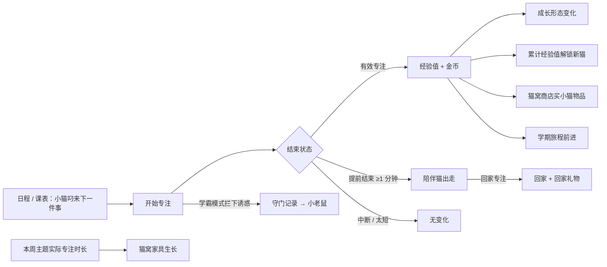
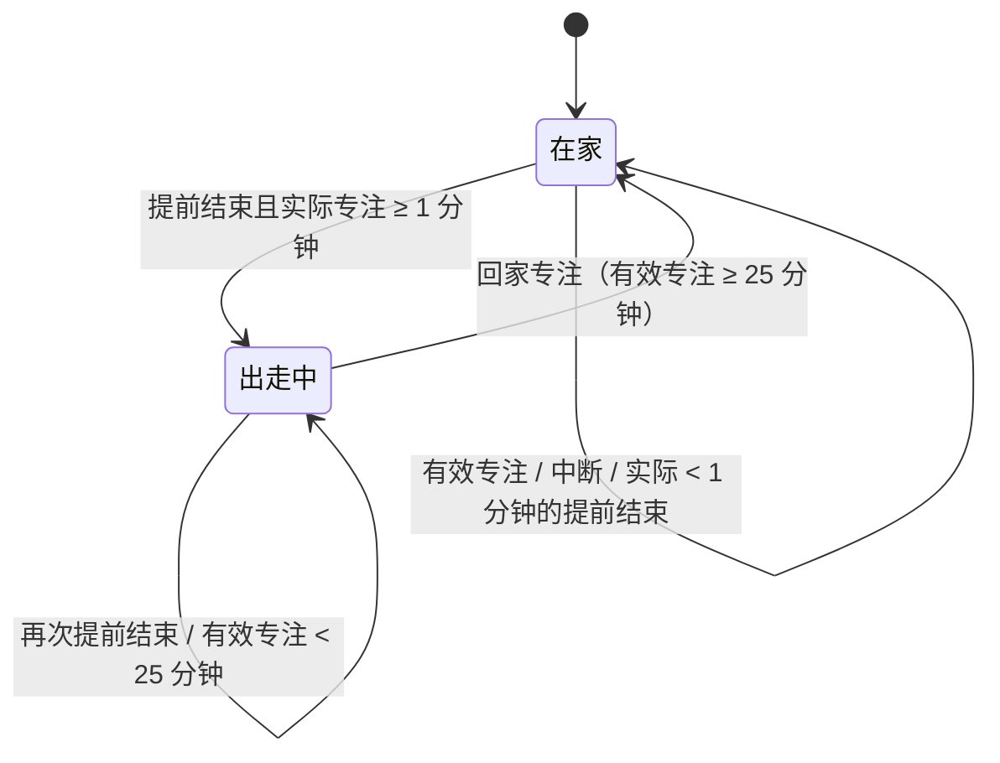
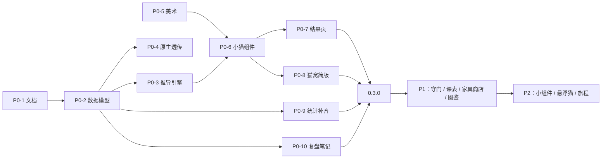

# 小猫专注 v2：小猫养成项目大纲

| 项 | 内容 |
| --- | --- |
| 状态 | **proposed**（草案，待用户逐条确认后转为 v2 基线） |
| 日期 | 2026-11-24 |
| 适用版本 | 0.3.x 起（当前线上 0.2.16） |
| 上游文档 | [requirements.md](requirements.md)（第 66、78 行：后续版本养成方向）、[v1-spec.md](v1-spec.md)、[GLOSSARY.md](../GLOSSARY.md)、[ux-spec.md](ux-spec.md)、[brand-spec.md](brand-spec.md)、[ADR 0001–0004](adr/) |
| 参考 | iOS「小鸡专注」商店图 [references/chickfocus](references/chickfocus/) |
| 本文不做的事 | 不改代码；不直接改写上游文档（修订清单见第 14 节） |

**目录**：1 背景与目标 · 2 竞品拆解 · 3 定位与人设 · 4 术语 · 5 核心循环与经济系统 · 6 模块需求（M0–M9） · 7 页面规格 · 8 美术与动效 · 9 技术方案 · 10 隐私与诚实边界 · 11 测试与验收 · 12 里程碑与 Issue 拆分 · 13 风险 · 14 文档修订清单 · 15 待决问题

---

## 1. 背景与目标

### 1.1 现状

v1（0.2.16）已交付完整专注工具链：常驻待办、正/倒计时、五分钟休息、日历与课表、统计、学霸模式（应用限制 / 严格模式 / 免打扰）、独立锁机、本地备份与应用内更新。小猫 Tab 仍是占位“小猫还未入驻”（`src/views/CatView.vue`，86 字节）。

### 1.2 问题

- 产品名叫“小猫专注”，但没有小猫；与普通番茄 / 待办工具没有情感差异。
- 用户已在 [requirements.md:66](requirements.md) 确认后续方向：“专注获得金币与经验，金币用于购买小猫房子、玩具等物品，经验推动升级、进化或解锁成长形态”，但未定数值、数量和失败反馈。
- 参考对象小鸡专注的核心卖点（养成 + 收集 + 放弃反馈）完全缺失。

### 1.3 目标

| # | 目标 | 衡量方式（本地优先，不接埋点） |
| --- | --- | --- |
| G1 | 追平小鸡专注的养成核心 | 功能对照表（第 2 节）“追平”项全部交付 |
| G2 | 形成 5 个可感知的差异化点 | 内测问卷：≥ 60% 受访者能说出至少 2 个“小鸡专注没有的东西” |
| G3 | 不破坏现有高频路径 | `ux-spec.md` R1-D 七项操作步数不增加；UX E2E 门禁全部通过 |
| G4 | 不制造焦虑 | 内测问卷“放弃后感受”选项中“愧疚 / 焦虑”占比 < 20% |
| G5 | 数据一致 | 备份恢复、删除记录、升级后，养成状态与专注记录 100% 一致（单元测试覆盖） |

### 1.4 非目标（v2 不做）

账号与云同步、排行榜、AI 助手、内购与广告、手表端、猫的实时 3D / 物理互动、App 使用统计、起床/睡眠打卡。

---

## 2. 竞品拆解：小鸡专注逐模块对照

| 小鸡专注模块 | 它怎么做 | 我们的处理 | 本文模块 |
| --- | --- | --- | --- |
| 专注页 | 中间一只小鸡 + 大号计时 + “左滑放弃” | **追平**：中间换成小猫，按成长形态和状态变化；控制方式保持现有暂停 / 结束 | M1、7.1 |
| 结束反馈 | 成功：鸡长大；放弃：鸡被吊起来，“完蛋！你的鸡挂了”，好感 −5 | **改造**：放弃 → 小猫出走，可找回，不扣分 | M3 |
| 好感与解锁 | 积攒好感解锁更多动物 | **改造**：用累计经验值解锁新猫，不另设好感货币 | M2 |
| 一周农场 | 本周养成的动物在农场散步 | **改造**：猫窝，家具由每个待办主题的本周时长长出来 | M6 |
| 成就徽章 | 各类徽章“堆成一堆” | **替代**：学期旅程纪念品 | M8 |
| 白名单拦截 | “专注中禁止使用”空白页 | **改造**：拦截页加小猫演出；被拦应用变成“小老鼠”战利品 | M4 |
| 时间轴 | 周条 + 记录卡 + 复盘笔记 + 周分布图 | **追平**：复盘笔记；**增量**：计划 vs 实际（已有）+ 按计划完成标记 | M0、M5 |
| 统计 | 日周月年总、放弃次数、热力图、按时长/次数、小鸡柱 | **追平**：提前结束次数、热力图、按次数、小猫柱 | M0 |
| 锁屏 / 实时活动 | 不解锁看进度，送小猫壁纸 | **追平**：通知换猫图标 + 进度；静态猫壁纸 | M7 |
| 小组件 | 时钟、今日、本月、热力、本周养鸡数 | **追平**：2×2、4×2 小组件 | M7 |
| 深色模式 | 有 | **待决**：`brand-spec.md` 锁定浅色（D4） | 15 |
| 无 | — | **增量**：懂课表、按计划完成、小猫叼来下一件事 | M5 |
| 无 | — | **增量**：桌面悬浮小猫（Android 独有） | M7 |
| 无 | — | **增量**：学期旅程与纪念册 | M8 |
| 无 | — | **增量**：金币与猫窝商店（用户既定方向） | M6 |

---

## 3. 定位与人设

### 3.1 一句话定位

**专注养一只猫：它会长大、会帮你看住手机、懂你的课表；你放弃了它只是出门逛逛，认真一次它就回家。**

### 3.2 宣传语候选（待决 Q1）

| 候选 | 适合位置 |
| --- | --- |
| **猫主子监督，不许玩手机** | 主宣传语（推荐） |
| **开局一只猫，替你看住手机** | 主宣传语（对标结构） |
| 放弃了猫会出走，坚持了猫会长大 | 副标题 / 商店第 2 张图 |
| 挡下一次诱惑，猫窝多一只小老鼠 | 商店介绍图 |
| 一个学期，陪猫走一趟远路 | 学期旅程介绍图 |

现有 `PRODUCT.md` 宣传语“专注此刻，陪小猫一起长大”和开屏副标可保留为开屏文案，不必同步替换。

### 3.3 小猫人设

| 维度 | 设定 |
| --- | --- |
| 性格 | 傲娇、话少、嘴硬心软；会监督你，但从不骂你 |
| 说话方式 | 短句，第一人称“我”，称用户为“你”；不使用感叹号堆叠、不卖萌叠字 |
| 禁止 | 威胁、羞辱、死亡、受伤、饥饿、“你让我失望了”类愧疚语言 |
| 招牌动作 | 伸懒腰、踩奶、把东西推下桌、蹲门口、尾巴卷成问号 |

### 3.4 文案示例库（首批，供实现直接使用）

| 场景 | 文案 |
| --- | --- |
| 正常结束 | “不错，今天的你比昨天坐得住。” / “我先睡会儿，你也歇歇。” |
| 出走 | “我去外面逛逛，你认真一次我就回来。” |
| 出走中再次开始 | “门开着呢，等你。” |
| 回家 | “我回来了，顺手给你带了点东西。” |
| 拦截页 | “这只小老鼠我先按住了。” / “专注中，手机归我管。” |
| 结束汇报 | “这轮我抓到 3 只小老鼠，按住了 12 条通知。” |
| 叼来下一件事 | “「背单词」的时间到了，我把它叼来了。” |
| 空档建议 | “下午 2–4 点空着，要不要去自习？” |
| 成长 | “我好像长大了一点。”（升到新成长形态） |
| 解锁新猫 | “有只新来的猫在门口张望。” |
| 学期旅程终点 | “这一路走完了。纪念册我帮你收好了。” |

---

## 4. 术语

### 4.1 沿用 `GLOSSARY.md` 已有术语（不改含义）

| 术语 | 本方案中的用法 |
| --- | --- |
| 经验值 | 有效专注产出，推动小猫成长；只能增加，不能消费 |
| 金币 | 有效专注产出，用于在猫窝商店购买小猫物品 |
| 小猫物品 | 玩具、装饰、地板、墙纸；以及回家礼物、旅程纪念品 |
| 成长形态 | 小奶猫 / 幼猫 / 少年猫 / 成年猫 / 特殊形态；**不得称“等级”** |
| 正常结束、提前结束、中断、实际专注时长、自由专注、日程、课表、学霸模式、锁机、白名单 | 含义不变 |

### 4.2 新增术语（需写入 `GLOSSARY.md`）

| 术语 | 定义 | _Avoid_ |
| --- | --- | --- |
| **有效专注** | 正常结束且实际专注时长 ≥ 5 分钟的一次专注；是经验值和金币的唯一来源 | 完成待办、成功 |
| **陪伴猫** | 当前在专注页和猫窝中心陪着用户、接收经验值的那只猫 | 主宠、当前等级猫 |
| **出走** | 倒计时提前结束且实际专注 ≥ 1 分钟时，陪伴猫离开猫窝的状态；不扣任何资源 | 死亡、挂了、失败、惩罚 |
| **回家** | 出走后的第一次“回家专注”使陪伴猫回到猫窝 | 复活 |
| **回家专注** | 出走期间实际专注 ≥ 25 分钟的有效专注 | — |
| **回家礼物** | 回家时随机获得的一件小猫物品 | 掉落、抽奖 |
| **守门记录** | 学霸模式或锁机期间被原生层实际拦下的应用、退出尝试与通知次数 | 违规次数、失败次数 |
| **小老鼠** | 某个被拦下应用的战利品形象，累计其被拦次数 | 黑名单、违规应用 |
| **猫窝** | 小猫 Tab 的主场景，包含家具、物品、战利品墙与陪伴猫 | 农场、家园等级 |
| **家具** | 与待办主题绑定、按该主题本周实际专注时长生长的猫窝陈设 | 小猫物品（家具不可购买） |
| **按计划完成** | 开始时被判定为对应某条日程的有效专注 | 完成日程、打卡 |
| **计划兑现率** | 某周期内已结束的关联待办日程中，被按计划完成的比例 | 完成率 |
| **学期旅程** | 以学期或考试日为终点、按经验值前进的长期路线 | 赛季、通行证 |
| **纪念册** | 学期旅程结束时生成的本地回顾页，可导出图片 | 年报、成绩单 |

### 4.3 文案禁用词（新增）

挂了、死了、饿死、失败、惩罚、违规、等级、Lv、抽卡、氪金、赛季、通行证、排行。

---

## 5. 核心循环与经济系统

### 5.1 核心循环



### 5.2 资源总表

| 资源 | 来源 | 去向 | 能否减少 | 存储方式 |
| --- | --- | --- | --- | --- |
| 经验值 | 有效专注分钟数 | 成长形态、解锁新猫、学期旅程 | 只在删除专注记录时回退 | 由专注记录推导 |
| 金币 | 有效专注、按计划完成、每日首次、回家 | 商店购买 | 购买扣除；删除记录时回退 | 收入推导，支出存购买记录 |
| 家具完整度 | 本周主题实际专注时长（含提前结束） | 猫窝展示 | 每周一重置 | 推导 |
| 守门记录 | 原生拦截事件 | 小老鼠战利品、结束汇报 | 只在删除记录时回退 | 写入专注记录 / 锁机记录 |
| 小猫物品 | 购买、回家礼物、旅程纪念品 | 猫窝摆放 | 不可出售 | 购买与摆放存 `cat` 文档；礼物和纪念品推导 |

> [!IMPORTANT]
> **守门记录不产出经验值和金币。**否则用户会故意打开抖音“刷小老鼠”。小老鼠只做展示。

### 5.3 经验值规则

| 规则 | 数值 |
| --- | --- |
| 单次经验值 | `floor(min(实际专注时长, 180 分钟) / 1 分钟)`，即 1 分钟 = 1 经验值 |
| 单次上限 | 180（防止正计时忘记结束） |
| 每日上限 | 600（按开始日期归属，与“专注次数归开始当天”一致） |
| 产出资格 | 仅有效专注；提前结束、中断、< 5 分钟均为 0 |
| 归属 | 记入该次专注开始时的陪伴猫 |
| 锁机 | 不产出（ADR 0004：锁机不进专注统计） |

### 5.4 成长形态阈值（每只猫独立累计）

| 成长形态 | 该猫累计经验值 | 约等于 | 外观要点 |
| --- | --- | --- | --- |
| 小奶猫 | 0 | 开局 | 毛团，大眼，走路不稳 |
| 幼猫 | 300 | 5 小时 | 能站稳，追尾巴 |
| 少年猫 | 1,500 | 25 小时 | 戴围巾，坐在书上 |
| 成年猫 | 6,000 | 100 小时 | 修长，趴在键盘上 |
| 特殊形态 Ⅰ | 18,000 | 300 小时 | 戴眼镜 |
| 特殊形态 Ⅱ | 30,000 | 500 小时 | 学士帽 |
| 特殊形态 Ⅲ | 每再 +20,000 | 每 333 小时 | 毛色 / 配饰轮换 |

达到成年猫后可在猫窝自由切换已获得的外观（成年猫及各特殊形态）。

### 5.5 新猫解锁与 10 品种完整档案（按所有猫的累计经验值总和）

配色遵守 `brand-spec.md` 黑白灰基调：每只猫以黑白灰构型为主，至多使用 1 个低饱和毛色/点缀色，不引入高饱和花哨配色。

| 序号 | `breedId` | 品种 | 解锁条件 | 主色 / 特征层 | 性格标签 | 专属短文案（示例） |
| --- | --- | --- | --- | --- | --- | --- |
| 1 | `black` | 黑猫（初始，与 `AppMark` 同源） | 开局 | `#222222` 纯黑 + 金眼 `#E7A54A` | 傲娇守门 | “不错，今天的你比昨天坐得住。” / “手机归我管。” |
| 2 | `orange` | 橘猫 | 总经验值 600（10 小时） | `#E09F5A` 暖橘条纹 + 白肚 | 爱晒太阳 | “干完这一轮，准你晒会儿太阳。” / “差不多得了，歇五分钟。” |
| 3 | `cow` | 奶牛猫 | 1,800（30 小时） | `#222222` + `#FFFFFF` 斑块 | 精力旺盛 | “别走神，我都盯着呢。” / “再来一轮？我陪你。” |
| 4 | `calico` | 三花 | 3,600（60 小时） | `#FFFFFF` + `#222222` + `#E09F5A` 三色耳斑 | 细心条理 | “按计划来，今天挺顺的。” / “桌上的事一件件收好。” |
| 5 | `tabby` | 狸花 | 6,000（100 小时） | `#6E6E73` 虎斑 + 额头 M 纹 | 冷静老练 | “心静下来，时间走得挺快。” / “这只小老鼠跑不掉。” |
| 6 | `siamese` | 暹罗 | 9,000（150 小时） | `#F2EDE4` 奶灰身 + `#3A3532` 重点色脸耳 | 嘴硬黏人 | “我不是在等你，只是刚好坐这儿。” / “怎么才回来。” |
| 7 | `ragdoll` | 布偶 | 13,200（220 小时） | `#F5F5F5` 长毛轮廓 + `#698CAA` 蓝眼 | 安静陪伴 | “慢慢来，不着急。” / “我在这儿陪着你。” |
| 8 | `sphynx` | 无毛猫 | 18,000（300 小时） | `#D9C7BE` 皱纹耳廓 + 毛衣配饰 | 极简高冷 | “别废话，开始吧。” / “效率还行。” |
| 特殊 | `traveler` | 旅行猫 | 学期旅程到达第 12 站终点（M8） | `#7B9A80` 围巾 + 小背包 | 见多识广 | “走完这一程，下一段也别怕。” / “纪念册收好了。” |
| 特殊 | `guardian` | 守门猫 | 累计守门记录 500 次（M4；唯一与守门挂钩的展示性奖励） | `#222222` + `#EF4E36` 小披风 | 铁面无私 | “门外那几只，我都替你按住了。” / “想开小差？没门。” |

新猫从小奶猫开始；切换陪伴猫在猫窝图鉴内完成，切换后新的经验值归新猫，旧猫保留原形态住在猫窝。

### 5.6 金币规则与结算优先级

| 来源 | 金币 | 触发条件与上限说明 |
| --- | --- | --- |
| 有效专注 | `floor(min(实际专注分钟, 180) / 5)` | 单次最多 36；仅有效专注（正常结束且 ≥ 5 分钟） |
| 按计划完成 | +3 / 次 | 有效专注且带有效 `planRef`，同一日程实例（`occurrenceId`）仅首次有效专注生效 |
| 每日第一次有效专注 | +2 | 按开始日（记录自带 `timeZone`）第一条有效专注发放 |
| 回家 | +5 | 出走状态下的“回家专注”（有效专注 ≥ 25 分钟） |
| 集齐礼物溢转 | +10 | 触发回家且 12 件回家礼物已全部拥有时替代礼物发放 |
| 每日上限 | 200 | 按开始日累计上述所有来源；超出部分截断：`awarded = min(raw, max(0, 200 - dayUsed))` |

**单次结算拆项优先级**（触发每日上限截断时按顺序计入，保证回放稳定）：`有效专注基础金币 → 按计划完成 → 每日首次 → 回家 → 礼物集齐溢转`。

以每天 2 小时、其中一半按计划为例：约 24 + 6 + 2 = 32 金币 / 天。

**余额**：`收入（推导） − 支出（购买记录）`。删除记录导致余额为负时显示为 0，已购物品保留，之后收入先抵扣欠额；界面不出现“欠款”字样。

### 5.7 商店完整物品目录（首批 24 件，P1）

全部物品总价 **2,410 金币**；按日均 32 金币计，约 **75 天**可买齐（符合 3 个月内买齐预期，且前 2 天即可买到首件玩具）。

| 编号 | 类别 | 名称 | 价格 | 槽位 | 交互 / 展示效果 | 简介 |
| --- | --- | --- | --- | --- | --- | --- |
| `SHOP-01` | 玩具 | 毛线球 | 20 | `toy_1` / `toy_2` | 陪伴猫走近轻推滚动 | “滚到墙角就会被拍回来。” |
| `SHOP-02` | 玩具 | 纸箱 | 25 | `toy_1` / `toy_2` | 陪伴猫钻进去露半个头 | “再贵的窝也比不上快递箱。” |
| `SHOP-03` | 玩具 | 逗猫棒 | 30 | `toy_1` / `toy_2` | 陪伴猫抬爪轻拍羽毛 | “别晃太快，我看得清。” |
| `SHOP-04` | 玩具 | 瓦楞猫抓板 | 35 | `toy_1` / `toy_2` | 陪伴猫偶尔趴着磨爪 | “省得我抓你的作业本。” |
| `SHOP-05` | 玩具 | 拨浪鼓鼠 | 40 | `toy_1` / `toy_2` | 轻轻摇摆 | “假的，但手感还行。” |
| `SHOP-06` | 玩具 | 隧道筒 | 45 | `toy_1` / `toy_2` | 猫窝闲逛时会穿过去 | “躲猫猫专用通道。” |
| `SHOP-07` | 玩具 | 漏食不倒翁 | 50 | `toy_1` / `toy_2` | 左右晃动 | “慢点吃，不着急。” |
| `SHOP-08` | 玩具 | 迷你猫爬架 | 60 | `toy_1` / `toy_2` | 陪伴猫跳到顶层俯视 | “站高一点，看得见你有没有摸鱼。” |
| `SHOP-09` | 装饰 | 便利贴墙 | 40 | `wall_1` / `wall_2` | 墙面静态陈设 | “贴满待办的角落。” |
| `SHOP-10` | 装饰 | 猫爪挂钟 | 50 | `wall_1` / `wall_2` | 指针显示当前小时分钟 | “滴答滴答，一小时很快就过去。” |
| `SHOP-11` | 装饰 | 黑白猫版画 | 70 | `wall_1` / `wall_2` | 墙面框画 | “自画像，别问像不像。” |
| `SHOP-12` | 装饰 | 仙人掌盆栽 | 45 | `window_1` | 窗台静态陈设 | “好养活，跟专注习惯一样。” |
| `SHOP-13` | 装饰 | 暖光台灯 | 80 | `floor_1` / `floor_2` | 夜间（19:00–06:00）自动点亮微光晕 | “晚自习也陪着你。” |
| `SHOP-14` | 装饰 | 懒人豆袋 | 100 | `floor_1` / `floor_2` | 非陪伴猫会躺上去 | “先声明，这是我的位子。” |
| `SHOP-15` | 装饰 | 黑胶小音箱 | 120 | `floor_1` / `floor_2` | 静态陈设（不强绑音频） | “安静也是一种背景音。” |
| `SHOP-16` | 装饰 | 纸灯笼吊灯 | 150 | `ceiling_1` | 顶部柔光造型 | “挂高一点，照亮整间窝。” |
| `SHOP-17` | 墙纸地板 | 浅木纹地板 | 100 | `floor_bg` | 替换默认灰白地板 | “踩上去不凉爪。” |
| `SHOP-18` | 墙纸地板 | 格纹地毯 | 140 | `floor_bg` | 替换地板为格纹织毯 | “冬天最适合踩奶。” |
| `SHOP-19` | 墙纸地板 | 鹅卵石阳台 | 200 | `floor_bg` | 替换地板为浅灰阳台砖 | “适合晒太阳的午后。” |
| `SHOP-20` | 墙纸地板 | 竖条纹墙纸 | 120 | `wall_bg` | 替换默认纯白墙面 | “清爽耐看。” |
| `SHOP-21` | 墙纸地板 | 砖纹书房墙 | 180 | `wall_bg` | 浅灰线描砖墙 | “像图书馆安静的角落。” |
| `SHOP-22` | 墙纸地板 | 星空夜幕窗墙 | 300 | `wall_bg` | 带大窗与浅描星点 | “熬夜不好，但今晚陪你。” |
| `SHOP-23` | 猫床 | 编织藤篮窝 | 200 | `bed_1` | 替换默认圆垫 | “边缘刚好架下巴。” |
| `SHOP-24` | 猫床 | 蓬松云朵垫 | 200 | `bed_1` | 替换默认圆垫 | “陷进去就不想起来了。” |

**默认自带（免费，不可购不可删）**：纯白墙面（`wall_default`）、极简浅灰地板（`floor_default`）、灰布圆垫（`bed_default`）。

### 5.8 防刷与边界

| 情况 | 处理 |
| --- | --- |
| 正计时开着不管 | 单次 180 上限 + 每日 600 上限 |
| 反复开 5 分钟倒计时 | 允许（真实专注）；金币按分钟计，不按次数计，无额外收益 |
| 修改系统时间 | 记录由原生单调时钟计时（现有 `SessionClock`），不受影响；日期归属按记录自带 `timeZone` 与 `startedAt` |
| 故意触发拦截 | 守门记录无经济收益；同一应用 3 秒内重复遮挡只计 1 次；拉回 2 秒内去重 |
| 删除专注记录 | 经验值、金币、旅程进度、回家判定全部重算；成长形态可能回退，界面不提示“降级” |
| 余额不足时快速连点购买 | `app.purchaseItem()` 在 `app.mutate()` 串行队列（`writeQueue`）内再次校验余额与是否已拥有，幂等防双扣 |
| 备份恢复 | 全部重算，见 9.6 |

---

## 6. 模块需求

每个模块包含：目标、规则、状态 / 边界、验收标准（Given / When / Then）。

### M0 统计与复盘补齐（追平，P0）

**目标**：统计和时间轴达到小鸡专注同等信息量，同时扩展现有 `src/domain/statistics.ts` 返回结构而不破坏既有调用。

**规则**

1. **提前结束次数**：统计概览新增“提前结束”格，口径为 `status === 'early' && durationMs >= 60_000` 且开始日落入当前统计区间（与现有 `count` 口径一致）。界面用“提前结束”，严禁用“放弃”或“失败”（`GLOSSARY.md`）。
2. **按时长 ⇄ 按次数切换**：统计顶栏左侧新增切换胶囊（默认 `按时长`），作用于趋势图与分布图，概览卡不受影响。`statistics()` 增量返回：
   - `earlyCount: number`（提前结束次数）
   - `dailyCount: [string, number][]`（按开始日归属的每日次数）
   - `hoursCount: number[]`（长度 24，按开始小时归属的每小时次数）
   - `categories`: 每行补充 `count: number`（按开始日落入区间的记录数）
   - 当切换为 `按次数` 时，分布图按 `count` 降序排序，tooltip 显示“X 次”。
3. **年度热力图（年视图）**：
   - 53 列 × 7 行（周一在顶行、周日在底行，对齐 `GLOSSARY.md` 周一起算习惯），容器支持横向平滑滚动（移动端 320–430 px 下单格 11×11 px、间距 3 px，默认滚动对齐到“今天”所在列，避免挤爆视口）。
   - 5 档精确分界（按当天实际专注时长 `dailyMs`）：
     - 0 档（`0 ms`）：`#F5F5F5`
     - 1 档（`1 ms .. < 30 min`）：`#DCDCE0`
     - 2 档（`30 min .. < 60 min`）：`#A8A8AE`
     - 3 档（`60 min .. < 120 min`）：`#66666B`
     - 4 档（`≥ 120 min`）：`#222222`
   - 今天格子加 `1.5 px #EF4E36` 描边。每个格子带完整 `aria-label`（如 `"2026年11月24日，专注 2 小时 10 分钟"`）。
   - 点击任意格子在热力图下方单行摘要区显示 `"11 月 24 日 · 2 小时 10 分 · 4 次"`（0 分钟时显示 `"11 月 24 日 · 无专注记录"`），**不弹窗**。
4. **小猫趋势柱**：
   - 达标判定：当前区间非零桶的算术平均值（日视图按非零小时、周/月按非零天、年/累计按非零月；全部为 0 时无达标柱）。达到或超过均值的柱子顶部画坐姿猫头（`CHART-CAT-UP`），低于均值且 > 0 的画趴姿猫头（`CHART-CAT-DOWN`），值为 0 的柱不画猫头。
   - 使用 ECharts `pictorialBar` + SVG path，与现有 `Chart.vue` 复用实例；`prefers-reduced-motion: reduce` 或关闭小猫动画时关闭柱生长动画（`animation: false`，与现有 `StatisticsView.vue:110` 保持一致）。
5. **复盘笔记**：
   - `FocusRecord.note?: string`，保存前执行 `trim()`，换行替换为空格，最大长度 **100 个 Unicode 字符**（超出截断并显示字数提示 `87/100`）；空字符串保存时删除 `note` 字段（保持 JSON 整洁）。
   - 三个入口：
     - **结果页**（`FocusView` 结束态）：次级文字链接“写一句复盘”，点击后在结果页**内联展开**输入框 + `[保存]` 按钮，保存后显示已保存笔记文本 + “编辑”，不弹 `<Sheet>`。
     - **统计记录详情**（`StatisticsView` 单 `<Sheet>` 的 `recordView === 'detail'`）：同弹窗内展示笔记区，点击“写复盘 / 编辑”原位切换输入框 + `[取消] [保存]`。
     - **日历时间轴记录详情**（`CalendarView` 单 `<Sheet>`）：同上原位切换，时间轴卡片内有笔记时显示灰色单行省略（`text-overflow: ellipsis`）。
   - 持久化链路：通过 `app.updateRecordNote(recordId, note)` → `app.mutate()` → `repository.save()` → `LocalStore.saveData()` 写回 `focus_records` 表（`upsertRecord`）；若记录已删除则静默忽略。

**验收**

- Given 本月 3 次提前结束（其中 1 次实际 40 秒），When 打开月统计，Then 提前结束次数显示 2。
- Given 年视图，When 点击某天格子，Then 页面内显示该日时长与次数，`dialog[open]` 数量为 0。
- Given 一条记录写了 100 字复盘笔记，When 导出 JSON 备份再恢复（或触发升级恢复副本），Then 笔记完整保留。
- Given 切换“按次数”，When 查看周趋势图与分类分布，Then 数值与排序切换为次数，概览总时长不变。

### M1 小猫成长（追平，P0）

**目标**：专注页和猫窝有一只会长大的猫。

**规则**

1. 首次打开新版本即拥有一只黑猫小奶猫（陪伴猫），默认名“团子”；**不强制命名**，开始专注路径不变。
2. 经验值、成长形态按 5.3、5.4 推导。
3. 升到新成长形态时：结束页插画换成新形态，并显示一行“团子长成了少年猫”；不弹窗、不放礼花。
4. 专注页小猫状态：

| 计时状态 | 小猫动作 |
| --- | --- |
| 进行中（普通） | 趴着陪伴，偶尔甩尾（每 20–40 秒一次轻动作） |
| 进行中（学霸模式） | 蹲在门口守门 |
| 已暂停 | 抬头看你，尾巴卷成问号 |
| 陪伴猫出走中 | 门缝探头的剪影 |
| 休息中（RestView） | 伸懒腰后打盹 |

**验收**

- Given 陪伴猫累计 290 经验值，When 完成一次 10 分钟倒计时，Then 结束页显示幼猫插画与“团子长成了幼猫”。
- Given 一次 4 分钟正常结束，Then 经验值、金币均不变。
- Given 当天已获 600 经验值，When 再完成 25 分钟，Then 经验值不变，统计时长照常增加。

### M2 新猫解锁与图鉴（追平，P1）

**规则**

1. 解锁条件见 5.5；达到时在下一次结束页显示“有只新来的猫在门口张望”，并在小猫 Tab 图标上显示一个灰点（非红点），进入猫窝后消失。
2. **图鉴**：猫窝 `⋯ → 猫咪图鉴`，网格展示全部品种；未解锁显示剪影和解锁条件（例如“累计 30 小时”）；已解锁显示当前最高形态与累计时长。
3. **切换陪伴猫**：图鉴内点某只猫 → 详情 → “让它陪我”。专注进行中不可切换（按钮置灰并说明“专注结束后可以换”）。
4. 每只猫可改名（≤ 8 字）。

**验收**

- Given 总经验值 599，When 完成 1 分钟以上有效专注使总值 ≥ 600，Then 结束页出现新猫提示，图鉴中橘猫变为可领养。
- Given 专注进行中，When 打开图鉴，Then “让它陪我”不可点。

### M3 出走与回家（增量 1，P0）

**目标**：保留放弃的情绪反馈，去掉惩罚。

**状态机**



**规则**

1. 出走只影响**专注开始时的陪伴猫**；切换陪伴猫不能“绕过”出走（出走猫回家前，图鉴里该猫标注“出门了”，新陪伴猫正常工作）。
2. 实际专注 < 1 分钟的提前结束视为“取消”，无任何反馈，也不计入提前结束次数（与 M0 一致）。
3. 严格模式倒计时不能提前结束，因此不会出走。
4. 正计时不存在提前结束，不会出走。
5. 中断（设备重启）不触发出走。
6. 出走期间：有效专注照常获得经验值和金币；猫窝陪伴猫位置变成空垫子 + 纸条；专注页显示探头剪影。
7. **回家礼物（首批 12 件完整目录）**：回家时从下表按 `fnv1a32(record.id) % 12` 确定起点，顺时针找第一件尚未拥有的礼物；保证纯函数推导在任意设备与恢复后结果完全稳定；全部 12 件集齐后改为发放 **+10 金币**（计入每日上限），文案改为“我回来了，路上捡了点亮晶晶的东西（+10 金币）”。

| 编号 | 礼物名称 | 猫窝礼物角 / 可摆放位 | 回家文案 |
| --- | --- | --- | --- |
| `GIFT-01` | 银杏叶书签 | 礼物角 / 墙面 | “路过操场，捡了片黄银杏给你夹书里。” |
| `GIFT-02` | 圆润鹅卵石 | 礼物角 / 窗台 | “河边挑的最圆那颗，摸起来很凉快。” |
| `GIFT-03` | 橡果小帽 | 礼物角 / 窗台 | “树底下找到的，刚好能盖住我指尖。” |
| `GIFT-04` | 蒲公英干花 | 礼物角 / 窗台 | “路上忍住没吹散，原样叼回来了。” |
| `GIFT-05` | 透明玻璃弹珠 | 礼物角 / 地面 | “亮晶晶的，你先收着，晚上借我拍两下。” |
| `GIFT-06` | 旧车票根 | 礼物角 / 墙面 | “不知道谁掉的，留着当书签刚好。” |
| `GIFT-07` | 松果 | 礼物角 / 窗台 | “松树底下滚出来一颗，味道很安静。” |
| `GIFT-08` | 粉色贝壳 | 礼物角 / 窗台 | “贴近听，好像有点像翻书的声音。” |
| `GIFT-09` | 铜色小纽扣 | 礼物角 / 地面 | “亮亮的，跟金币差不多好看。” |
| `GIFT-10` | 四叶草压花 | 礼物角 / 墙面 | “找了半天，算你今天运气好。” |
| `GIFT-11` | 彩色小羽毛 | 礼物角 / 窗台 | “风吹过来的，我可没欺负小鸟。” |
| `GIFT-12` | 糖纸折星 | 礼物角 / 窗台 | “路边长椅上看到的，顺手叼回来了。” |

8. 出走不叠加：连续多次提前结束，仍只需一次回家专注。
9. **与升级追溯的边界**：若采用 Q3 方案 B，升级点 `retroCutoffAt` 之前的历史提前结束记录**不触发**出走状态，避免老用户一升级进猫窝就看到空垫子。

**结束页文案**：见 3.4。出走结果页主按钮“返回待办”，次按钮“再来一次”（沿用现有“再来一轮”逻辑）。

**验收**

- Given 在家，When 25 分钟倒计时在第 10 分钟结束，Then 结果页显示出走插画；猫窝显示空垫子；统计提前结束次数 +1；经验值不变。
- Given 出走中，When 完成一次 30 分钟有效专注，Then 结果页显示回家插画 + 礼物名，金币 +5（另加常规收入）。
- Given 出走中，When 删除导致出走的那条记录，Then 状态重算为在家，回家礼物随之回退。

### M4 守门员：拦截演出与小老鼠（增量 3，P1）

**目标**：把已有的拦截能力变成看得见的成果。

**守门记录来源（原生层写入 + 落盘防杀丢数）**

| 事件 | 原生挂点（现有代码） | 计数规则 |
| --- | --- | --- |
| 打开白名单外应用被遮挡 | `FocusBlockOverlay.showBlockedApp(...)` / `FocusAccessibilityService` / `UsageAppMonitor` | 按包名累计；同包 3 秒内去重（单调时钟 `clock.mono()`） |
| 严格模式拉回（桌面 / 最近任务 / 防关闭） | `FocusBlockOverlay.showGuardPullback(...)`、`FocusAntiClose`、`FocusNavigation` | `exitBlocks` +1；2 秒内去重 |
| 通知被拦截 | `NotificationProtection.hold(...)`（仅首次成功对某条新 `notice.key + postTime` 发起暂缓时计数，续租不重复计） | `heldNotifications` +1 |

**防进程被杀丢数机制**：新增轻量持久化类 `GuardCounter`，将本轮计数实时写入 SQLite `LocalStore` 的 `documents.activeGuard`（含 `sessionId`、`blockedApps`、`exitBlocks`、`heldNotifications`、`lastMonoByKey`）。当 `FocusKeepAliveService` 重拉进程或 `rebootResumeLock` 重启续锁时，按 `sessionId` 续接计数；当 `FocusEngine` / `LockEngine` 结算时，在同一个 `LocalStore` 事务内读取并写入记录的 `guard` 字段（全为 0 时省略 `guard` 字段），同时清空 `activeGuard`。

```ts
interface GuardSummary {
  blockedApps: { packageName: string; label: string; count: number }[]
  exitBlocks: number
  heldNotifications: number
}
// FocusRecord.guard?: GuardSummary
// LockRecord.guard?: GuardSummary
```

**拦截页演出（原生 `FocusBlockOverlay`）**

- `BLOCKED_APP` / `GUARD_PULLBACK` 遮挡页插画区：小猫一爪把手机推下桌（600 ms，单次播放）；减少动态效果或系统设置关闭动画时直接显示最终帧。
- 文案替换现有标题区（如“这只小老鼠我先按住了。” / “专注中，手机归我管。”），白名单应用快捷切换列表与底部安全出口“遇到问题？紧急与故障恢复”位置、文字、2 步可达性完全不变（`ux-spec.md` 2.2-10）。
- 原生遮挡页使用 Android 矢量动画（`AnimatedVectorDrawable`），不依赖 WebView，零延迟渲染。

**结束汇报**：结果页统计行下方一行：“这轮我抓到 3 只小老鼠（抖音 ×2、微博 ×1），按住了 12 条通知。”（仅拦截应用时省去通知半句，仅拦通知时写“这轮我按住了 12 条通知”，仅有拉回时写“这轮我替你守住了 2 次桌面切换”；无守门记录时不显示该行）。

**小老鼠与战利品墙**

| 累计被拦次数 | 小老鼠外观 |
| --- | --- |
| 1–9 | 灰色小老鼠，身上印应用名首字 |
| 10–49 | 戴铃铛 |
| 50–99 | 被装进玻璃罐 |
| ≥ 100 | 罐子上有小猫爪印 |

- 战利品墙最多展示 8 只（按累计次数降序，同次数按最近被拦时间降序），其余在“全部战利品”列表中。
- 只存包名、应用名和次数，**不存通知正文**（与现有通知释放策略一致）。
- 锁机记录的守门记录计入战利品墙（由 `deriveCat(data, lockRecords, now)` 汇总），但不计入任何经验值和金币（严格遵守 ADR 0004）。
- **备份口径**：升级恢复副本（`BusinessBackupData.snapshot()`）保留 `lockHistory.records[].guard`；手动 JSON 备份（`src/domain/backup.ts`）同时支持可选 `lockHistory` 字段，确保换机导入后锁机抓到的小老鼠不丢失。

**验收**

- Given 学霸模式专注中，When 2 秒内连续 3 次打开抖音被遮挡，Then 结束汇报显示“抖音 ×1”。
- Given 未开启学霸模式，When 专注结束，Then 结果页无汇报行，经验值照常。
- Given 遮挡页，When 系统开启减少动态效果，Then 不播放动画，安全出口 2 步可达。

### M5 懂课表：按计划完成（增量 2，P1）

**目标**：用只有我们有的课表和日程数据，奖励“说到做到”。

**按计划判定**（在**开始专注时**由 Vue 计算并写入会话，之后不随日程修改、删改而变化）

一次专注在开始时满足以下任一条件，即记 `planRef`（`occurrenceId` 复用 `src/domain/calendar.ts` 格式 `${event.id}/${sourceDate}`）：

1. 从日历日程详情“开始专注”入口开始（`CalendarView.startFromEvent`），且该日程为 `kind: 'event'`（含直接关联待办与未关联待办的普通日程——若未关联待办，以日程标题发起自由专注并带 `planRef`）；
2. 从“小猫叼来”通知的“开始专注”按钮开始；
3. 从待办页（`TasksView.begin`）或结果页“再次开始”开始，且该 `itemId` 关联了某条未取消、非全天的 `event` 实例，当前时间 `now` 落在该实例 `[start - 15 min, end]` 窗口内。
   - **多条日程重叠消歧**：若同一 `itemId` 同时匹配到多个日程实例，优先排除已关联过有效专注的实例；若仍有多个，取 `|now - startMs|` 最小者，同距取 `startMs` 更早者，再同取 `occurrenceId` 字典序更小者。

```ts
interface PlanRef { occurrenceId: string; sourceId: string; sourceDate: string; kind: 'event' }
// ActiveFocus.planRef?: PlanRef → FocusEngine 结算时透传写入 FocusRecord.planRef
```

只有该次专注最终是**有效专注**才算“按计划完成”；同一 `occurrenceId` 只算一次（按 `startedAt` 升序取最早的有效专注，避免重复刷 +3 金币）。课程（`kind: 'course'`）不参与按计划判定。

**计划兑现率口径**（周视图与猫窝周统计）：
- **分母（计划数）**：所查看自然周内，所有 `kind === 'event'`、非全天、未取消且**关联了 `itemId`**、并且 `startMs <= now`（已到达开始时间）的日程实例数（历史周即整周所有关联待办日程实例）。避免周一早上显示“1 / 12”制造焦虑。
- **分子（按计划完成数）**：上述分母实例中，存在至少一条 `record.planRef?.occurrenceId === occ.id` 且为有效专注的实例数。
- 当分母为 0 时隐藏“按计划 X / Y”文案，不显示 `0/0`。

**功能**

| 功能 | 规则 | 默认 |
| --- | --- | --- |
| 小猫作息 | 当前时间落在当前学期有效课程实例内（含 `courseExceptions` 调课、不含停课）或本地时间 23:00–07:00：猫窝陪伴猫睡觉，猫窝顶部不显示空档建议 | 开 |
| 小猫叼来下一件事 | **升级而非新增通知**：在 `Reminders.sync()` 调度关联了 `itemId` 的日程提醒时（触发时刻仍为 `start - reminderMinutes`，不另发第二条通知），携带 `occurrenceId / sourceId / sourceDate / itemId / title`。`ReminderReceiver` 收到后，若当下 `LocalStore` 无进行中专注/休息/锁机，则渲染文案“「背单词」的时间到了，我把它叼来了”并附“开始专注”操作按钮；若已有进行中会话，则不附按钮，仅静态提示 | 跟随该日程的 `reminderMinutes` |
| 空档建议 | 猫窝顶部一行，每天最多 1 条（用户点右侧 `×` 可当日关闭，记 `localStorage` 当日键）：在今天 `max(now + 10 min, 08:00)` 至 `22:00` 内，去除全部课程（当前学期）与日程占用区间后，寻找最早一段连续 ≥ 60 分钟的空闲时段，取整 15 分钟展示如“下午 2:00–4:00 空着，要不要去自习？”。今天无 ≥ 60 分钟空档或处于上课/23:00–07:00 则不显示 | 开（可在“我的 → 小猫”关闭） |
| 按计划奖励 | 金币 +3（受每日上限约束） | — |
| 计划兑现率 | 猫窝周统计与统计周视图：“本周按计划 8/10” | — |
| 日历标记 | 时间轴实际记录卡右上角小猫爪图标；日程详情显示“已按计划完成 · 25 分钟” | — |

**原生与前端交接链路（“开始专注”通知按钮）**：
1. 用户点通知按钮 → `MainActivity` 收到带 `planStart` JSON extra 的 Intent → 存入挂起字段并派发 `window` 事件 `plan-start-request`（复用 `focus-return-request` 模式）。
2. `App.vue` 监听 `plan-start-request`（冷启动时在 `app.init()` 完成后调用 `consumePlanStart()`）。
3. 校验：若已有进行中专注/锁机/休息，或目标 `itemId` 已被删除 → Toast 轻提示并路由至 `/tasks`；否则用该 `item` 的默认模式/时长 + `planRef` 调用 `app.start()`。
4. 若触发未确认的严格倒计时或原生缺权/待恢复错误 → 复用 `ux-spec.md` §2.2-4 的单层确认/恢复弹窗（不阻塞、不静默吞错）。

**验收**

- Given 日程“背单词 14:00–15:00”关联待办，When 13:50 从待办点开始并有效结束，Then 记录带 `planRef`，金币额外 +3，日历显示爪印。
- Given 上述记录已产生，When 把日程改到 16:00 或删除日程，Then 该记录仍算按计划完成且金币不回退。
- Given 已有进行中专注，When 收到叼来通知，Then 通知没有“开始专注”按钮。
- Given 未授予通知权限，Then 叼来通知静默不发，不出现红标或弹窗。
- Given 关联待办的日程设置了提前 10 分钟提醒，When 到达 13:50，Then 只收到 1 条“小猫叼来”通知（不重复弹旧提醒）。

### M6 猫窝与商店（追平 + 改造，P0 简版 / P1 完整）

**目标**：小猫 Tab 变成可以待着的地方；猫窝的样子就是这周的时间分配。

**场景构成**

| 层 | 内容 | 数据来源 |
| --- | --- | --- |
| 背景 | 墙纸 + 地板（可购买替换） | `cat.placements` |
| 家具位 ×4 | 本周实际专注时长前 4 的待办主题，各一件家具 | 推导 |
| 装饰位 ×6 | 墙面 2、窗台 1、地面 2、天花板 1 | `cat.placements` |
| 玩具位 ×2 | 陪伴猫会走过去玩 | `cat.placements` |
| 猫床 | 陪伴猫睡觉处 | `cat.placements` |
| 战利品墙 | 小老鼠，最多 8 只 | 推导（M4） |
| 陪伴猫 | 按成长形态 + 作息 + 出走状态 | 推导 |
| 其他猫 | 已领养的非陪伴猫在场景边缘闲逛（最多显示 3 只） | 推导 |

**家具规则（8 种主题家具与 3 档视觉形态完整表）**

| `furnitureId` | 名称 | 1 档：草图（1–3 小时） | 2 档：半成品（3–6 小时） | 3 档：完整（≥ 6 小时） |
| --- | --- | --- | --- | --- |
| `desk` | 书桌 | 虚线木桌轮廓 | 实线书桌 + 一本摊开的书 | 书桌 + 书堆 + 笔筒 + 小台历 |
| `bookshelf` | 书架 | 虚线空架子 | 实线书架 + 半层书 | 满格书架 + 书立 + 折叠小梯 |
| `lamp` | 落地灯 | 虚线灯杆与灯罩 | 实线落地灯（未点亮） | 实线落地灯 + 柔和暖光圈 |
| `globe` | 地球仪 | 虚线底座与圆环 | 实线地球仪 | 地球仪 + 旁边叠放地图卷 |
| `piano` | 小电钢 | 虚线琴架 | 实线琴身 + 琴键 | 琴身 + 乐谱架 + 节拍器 |
| `easel` | 画架 | 虚线三角架 | 实线画架 + 空白画布 | 画架 + 猫咪简笔画 + 调色盘 |
| `dumbbell` | 哑铃架 | 虚线地垫 | 实线瑜伽垫 + 一对哑铃 | 瑜伽垫 + 哑铃架 + 跳绳 |
| `plant` | 窗台花盆 | 虚线空花盆 | 实线花盆 + 两片嫩芽 | 枝叶舒展 + 一朵 `#EF4E36` 小花 |

1. 每个待办主题可在主题编辑的折叠区“更多设置”中选家具（上述 8 种）；未选时按主题在 `themes` 中的 `order` 顺序模 8 自动分配。
2. 完整度按该主题**本周**实际专注时长（按自然周周一 00:00 至周日 23:59，与统计 `intervalBuckets` 口径一致，包含提前结束）：≥ 1 小时草图、≥ 3 小时半成品、≥ 6 小时完整；< 1 小时不显示。
3. **前 4 名槽位排序与稳定性**：取本周时长 ≥ 1 小时的待办主题，按 `totalMs DESC → theme.order ASC → themeId ASC` 取前 4 名，依次落入 4 个固定家具槽位 `furn_1`（左上）、`furn_2`（右上）、`furn_3`（左下）、`furn_4`（右下）。
4. 软删除主题兼容：若某主题本周已有记录后被删除（`theme.deleted === true`），推导时优先读记录自带的 `themeName` / `color` 与 `themes` 中保留的软删除条目（含 `furnitureId`），保证本周与历史周快照不丢家具。
5. 每周一 00:00（本地时区）重新生长；自由专注不生成家具，但计入经验值和金币。
6. 点击家具 → 同一 `<Sheet>`（`view = 'furniture'`）显示“数学 · 本周 4 小时 20 分 · 半成品 · 再专注 1 小时 40 分就完整了”。

**一周快照**：顶部周切换 `‹ 第 47 周 ›`（按所选周周一日期计算自然周范围与标题，如 `11/18 – 11/24`）查看历史周的家具和当周抓到的小老鼠（用当周记录推导；装饰、猫的外观显示当前状态；禁止切到未来周）。

**商店**（P1）：猫窝 `⋯ → 小猫商店`，同一 `<Sheet>` 内三段切换（玩具 / 装饰 / 墙纸地板含猫床）；每件显示名称、价格、已拥有标记；购买为内联二次确认条“花 60 金币买毛线球？[取消] [买下]”；余额不足时“买下”置灰并显示“还差 X 金币”；买下后直接切至 `view = 'arrange'` 进入摆放（选槽位），也可随时在 `⋯ → 布置猫窝` 中调整或收起。

**P0 简版**：只有背景（默认墙地）、陪伴猫（含作息 / 出走）、礼物角（展示回家礼物）、周统计行、主 CTA；家具、商店、战利品墙、多猫闲逛放到 P1。

**验收**

- Given 本周数学 3.5 小时、英语 0.5 小时，Then 猫窝只显示数学家具（半成品）。
- Given 周一 00:00 后打开猫窝，Then 本周家具清空，`‹` 可看到上周快照。
- Given 余额 50，When 购买 60 金币物品，Then “买下”不可点，显示“还差 10 金币”。
- Given 任何子视图打开，Then `dialog[open] ≤ 1`。

### M7 桌面小组件、悬浮小猫、锁屏（增量 4，P2）

| 能力 | 规则 |
| --- | --- |
| 小组件 2×2 | 陪伴猫（当前形态 + 状态）+ 今日专注时长与次数；点击打开应用 |
| 小组件 4×2 | 今日 / 本月时长与次数 + 近 4 周热力条 + 猫窝缩略；点击打开猫窝 |
| 刷新时机 | 专注结束、休息结束、日期变更（`ACTION_DATE_CHANGED`）、进入应用；不常驻刷新 |
| 数据 | Vue 推导后通过新插件方法 `saveWidgetCache()` 写入 `documents.widgetCache`；原生 `AppWidgetProvider` 只读缓存（缓存不是数据源，可随时重算） |
| 悬浮小猫（默认关） | 仅在**普通专注（未开学霸模式）**且主应用处于后台（`!FocusBlockOverlay.isMainForeground()`）时显示：屏幕边缘 56 dp 小猫头 + 剩余时间胶囊，可拖动吸边，点击回 `/focus`；回到应用、进入休息、专注结束或开启学霸模式/锁机时**立即销毁**，绝不与 `FocusBlockOverlay` 同屏冲突；复用已有 `SYSTEM_ALERT_WINDOW` 权限，未授权时设置项置灰并说明“开启悬浮窗权限后可用” |
| 专注常驻通知 | 小图标换成陪伴猫当前形态剪影；保持现有 `FOCUS_ID = 40` 单条通知，不新增通知 |
| 实时进度 | Android 16 起尝试 `Notification.ProgressStyle`；不支持时保持现状 |
| 小猫壁纸 | 猫窝 `⋯ → 保存猫壁纸`：按当前设备屏幕比例（默认 1080×2400，背景 `#FFFFFF`）渲染当前陪伴猫 + 猫窝为竖版 PNG，通过现有 `exportFile` 保存；**不做动态壁纸**（避免与 `FORCE-06` 壁纸保护增强冲突） |

**验收**：小组件在专注结束 5 秒内更新；关闭悬浮小猫时，切出应用不出现任何悬浮窗；学霸模式下悬浮小猫不出现（由全屏遮挡接管）；普通专注切回应用时悬浮小猫 0 残留。

### M8 学期旅程与纪念册（增量 5，P2）

**规则**

1. **创建**：猫窝 `⋯ → 学期旅程`。默认起点 = 当前学期开始日期，终点 = 学期结束日期（`startDate + weeks × 7`）；也可自定义名称（≤ 16 字）与终点考试日（起点默认为今天，终点须至少晚于起点 7 天）。没有学期时提示“先在日历里建一个学期，或直接选一个考试日”。
2. **强度**（创建时选，之后不可改）：轻松 6 小时 / 站（共 72 小时）、标准 10 小时 / 站（共 120 小时）、冲刺 15 小时 / 站（共 180 小时）；固定 12 站。
3. **前进**：旅程日期区间 `[start, end]` 内产生的有效专注经验值（按开始日归属，受每日 600 上限约束）累计换算站数：`reachedStation = min(12, floor(journeyXp / (pace * 60)))`；进度永不后退，除非删除记录。
4. **12 站与 12 件纪念品完整表**（到达该站立即解锁对应纪念品，作为小猫物品可摆进猫窝）：

| 站号 | 站点名 | 纪念品 ID | 纪念品名称 | 摆放槽位 | 到站短文案 |
| --- | --- | --- | --- | --- | --- |
| 1 | 起点小镇 | `SOUV-01` | 站台小木牌 | 墙面 / 窗台 | “收拾好行囊，第一步算数。” |
| 2 | 图书馆 | `SOUV-02` | 铜质藏书票 | 墙面 | “借书证盖上第一个章。” |
| 3 | 海边 | `SOUV-03` | 海风玻璃瓶 | 窗台 | “装了一点咸咸的风。” |
| 4 | 麦田 | `SOUV-04` | 麦穗束 | 窗台 / 地面 | “风吹过来的时候，沙沙响。” |
| 5 | 山脚 | `SOUV-05` | 登山小指南针 | 窗台 | “方向没偏，继续往上走。” |
| 6 | 雪山 | `SOUV-06` | 雪花水晶球 | 窗台 | “半程了，摇一摇会下雪。” |
| 7 | 灯塔 | `SOUV-07` | 迷你灯塔模型 | 地面 / 窗台 | “天黑也不怕，亮着灯呢。” |
| 8 | 古城 | `SOUV-08` | 青瓦猫摆件 | 窗台 | “瓦片上的猫跟我长得有点像。” |
| 9 | 森林 | `SOUV-09` | 苔藓小罐 | 窗台 | “林子里最适合安心看书。” |
| 10 | 星空营地 | `SOUV-10` | 折叠露营灯 | 地面 | “离终点只剩两站了。” |
| 11 | 火车站 | `SOUV-11` | 远行小行李箱 | 地面 | “车快到站，再稳一程。” |
| 12 | 终点站 | `SOUV-12` | 终点纪念徽章框 | 墙面 | “这一路走完了。纪念册我帮你收好了。” |

5. **到期结算**：终点日期过后第一次打开应用，标记旅程可查看纪念册；未走完 12 站也正常生成，文案“这学期走到了第 8 站（古城）”，严禁使用失败字样。
6. **到达终点**：到达第 12 站（无论是否已到终点日期）即解锁特殊品种“旅行猫”（5.5）。
7. **纪念册 7 页逐页规格**（同一 `<Sheet>` 内左右翻页 + 底部页码点 `1/7`）：
   - **P1 封面**：陪伴猫当前形态插画 + 旅程名 + 起止日期 + “走了 X / 12 站”。
   - **P2 总览**：总专注时长、有效专注次数、活跃天数、计划兑现率（无计划时隐藏）。
   - **P3 主题分布**：前 5 待办主题水平条形图（按实际时长，含颜色点）。
   - **P4 守门战绩**：旅程期间抓到最多的 5 只小老鼠 + 拦下通知总数（无守门记录时自动跳过本页，共 6 页）。
   - **P5 成长时间线**：期间陪伴猫跨过的成长形态节点与达成日期（无变化时展示“一直陪在你身边”）。
   - **P6 最长的一天**：旅程期间专注时长最高的单日日期、总时长与当天第一条复盘笔记（如有）。
   - **P7 结束语**：小猫专属结语 + 主按钮 `保存为图片`（Canvas 渲染竖版长图，通过 `exportFile` 保存，不上传）。
8. 同一时间只能有一个进行中的旅程（`today <= end`）；历史纪念册收纳于猫窝 `⋯ → 纪念册`，可随时重看。

**验收**：Given 标准强度、旅程期间累计 25 小时，Then 位于第 2 站与第 3 站之间，已获 2 件纪念品；Given 终点已过，When 打开应用，Then 猫窝显示纪念册入口，旅程状态为已结束。

### M9 新手引导与小猫设置（P0）

**新手引导**

- 新用户与升级用户第一次进入**小猫 Tab**时显示单页：“一只小奶猫来了”+ 插画 + 名字输入框（默认“团子”）+ 唯一主按钮“就叫它团子”（随输入变化）。跳过即用默认名。
- **不在待办页、专注页插入任何引导**，保持 1 步开始专注。
- 升级用户：历史有效专注**追溯计入**经验值和金币（待决 Q3），引导页额外一行“你之前认真过的 42 小时，它都记着”。

**我的 → 小猫**（新增一组，≤ 4 项）

| 项 | 类型 | 默认 |
| --- | --- | --- |
| 陪伴猫名字 | 输入 | 团子 |
| 空档建议 | 开关 | 开 |
| 专注时显示悬浮小猫（P2） | 开关 | 关 |
| 小猫动画 | 开关（关 = 全部静态帧） | 跟随系统减少动态效果 |

---

## 7. 页面规格

所有页面遵守 `ux-spec.md` R1（≤ 1 主 CTA、≤ 4 决策项、0 嵌套弹窗、主屏无工程状态、高频 ≤ 2 步）与 `brand-spec.md`（`#FFFFFF / #F5F5F5 / #222222 / #737378 / #EF4E36`、24 px 边距、20 px 圆角、≥ 12 px 辅文、≥ 48 px 触控）。

### 7.1 专注页 FocusView（改）与原生全屏覆盖协同

```text
┌──────────────────────────────────────┐
│ [‹ / 🔒]      [待办主题]       [⋯]   │  ← 不变（沿用现有顶栏）
│                                      │
│            倒计时专注                │
│          ┌──────────────┐            │
│          │  (小猫插画)  │            │  ← 新增：160×160 dp，按成长形态 + 状态
│          └──────────────┘            │
│               24:59                  │  ← 不变
│              背单词                  │
│            ● 专注进行中              │
│                                      │
│         ( ‖ )        ( ■ )           │  ← 不变
└──────────────────────────────────────┘
```

减法清单：不新增按钮；不显示经验值进度条；不显示金币。窄屏（高度 < 640 dp）插画缩到 112 dp。

#### 7.1.1 安卓原生 `FocusBlockOverlay` 双端一致规则（关键基线约束）

在 Android 实机上，当用户授予悬浮窗或无障碍权限后，`FocusBlockOverlay` 在普通专注（`Mode.NORMAL_FOCUS`）与学霸锁屏（`Mode.STUDY_LOCKED`）下会全屏覆盖 `/focus`（详见 `ux-spec.md` §2.2-10）。为避免“WebView 有小猫、安卓原生看不见小猫”的割裂：

1. **视觉同步**：`ActiveFocus` 会话启动时同步携带 `companionBreedId`、`companionForm`、`companionAway`（轻量展示快照，不作数据源）；`FocusBlockOverlay` 在 `NORMAL_FOCUS` 与 `STUDY_LOCKED` 计时数字上方渲染对应的 Android `VectorDrawable` 静态小猫图（120×120 dp，不依赖 WebView），出走中渲染门缝探头剪影。
2. **路由抑制修正**：`FocusBlockOverlay.updateRouteState()` 现有安全路由白名单须补齐 `/cat`、`/calendar`、`/statistics`（对齐 `src/main.ts` 实际路由名，修复现有 `/stats`、`/schedule` 命名偏差），确保普通专注期间切去猫窝查看时不误弹出全屏覆盖。
3. **悬浮小猫互斥**：仅在 `Mode.NORMAL_FOCUS` 且 `mainForeground == false` 时允许 `FloatingCatBubble`（P2）显示；只要切回主应用或进入 `STUDY_LOCKED` / `BLOCKED_APP` / `GUARD_PULLBACK`，`FloatingCatBubble` 立即 `dismiss()`。

### 7.2 结果页（FocusView 结束态，改）

```text
有效专注                    出走                       回家
┌────────────────────┐   ┌────────────────────┐   ┌────────────────────┐
│   (猫伸懒腰)       │   │ (猫背包袱 + 纸条)  │   │ (猫叼礼物进门)     │
│ 本次专注正常结束   │   │ 提前结束           │   │ 本次专注正常结束   │
│ 25 分钟 · 暂停 0   │   │ 10 分钟 · 暂停 0   │   │ 30 分钟 · 暂停 2   │
│ +25 经验 · +5 金币 │   │ 我去外面逛逛，     │   │ 我回来了，顺手带了 │
│ 抓到 2 只小老鼠    │   │ 你认真一次我就回来 │   │ 「毛线球」         │
│ 写一句复盘         │   │                    │   │ +30 经验 · +11 金币│
│ [  开始休息  ]     │   │ [  返回待办  ]     │   │ [  开始休息  ]     │
│   再次开始         │   │   再来一轮         │   │   再次开始         │
└────────────────────┘   └────────────────────┘   └────────────────────┘
```

- 收益行一行，灰色辅文；超过每日上限时显示“今天的经验已经满了，时长照常记录”。
- 中断结果页不显示小猫状态变化，只显示原有文案。

### 7.3 休息页 RestView（改）

只把顶部图标换成打盹的陪伴猫；其余不变。

### 7.4 猫窝 CatView（重做）

```text
┌──────────────────────────────────────┐
│ 猫窝           ‹ 第 47 周 ›    [⋯]   │  ← ⋯：图鉴 / 商店 / 布置 / 旅程 / 纪念册 / 壁纸
│ 下午 2–4 点空着，要不要去自习？      │  ← 空档建议（可关，每天 ≤ 1）
│ ┌──────────────────────────────────┐ │
│ │ [战利品墙: 🐭抖×37 🐭微×5 …]      │ │
│ │  [书架·数学]       [台灯·英语]    │ │
│ │             (团子)                │ │  ← 点猫：显示名字、形态、距下一形态
│ │  [书桌·物理]       [毛线球]       │ │
│ └──────────────────────────────────┘ │
│ 本周 12 小时 · 按计划 8/10 · 🪙 326  │
│ 团子 · 少年猫 · 距成年猫 41 小时     │
│        ( ▶ 陪团子专注 25 分钟 )      │  ← 唯一主 CTA = 自由专注（默认时长）
└──────────────────────────────────────┘
```

**状态**

| 状态 | 表现 |
| --- | --- |
| 首次进入 | M9 引导页 |
| 出走中 | 中心空垫子 + 纸条“出门逛逛，认真一次就回来”；主 CTA 文案“去把团子找回来” |
| 睡觉（上课 / 深夜） | 猫睡在猫床；不显示空档建议 |
| 有进行中专注 | 主 CTA 变为“回到专注”（直达 `/focus`） |
| 历史周 | 主 CTA 隐藏，顶部显示“回到本周” |

**子视图全状态转移表**（`CatView.vue` 全局仅维护 **1 个** `<Sheet>` 容器，严格遵守 `ux-spec.md` §3.1 单容器规则，`dialog[open] <= 1`）：

| `sheetView` | 标题 `title` | 返回头 `backLabel` | 进入方式 | 核心内容与空态 / 错误态 |
| --- | --- | --- | --- | --- |
| `menu` | 更多 | — | 点顶栏 `⋯` | 列表入口：猫咪图鉴 / 小猫商店（P1）/ 布置猫窝（P1）/ 学期旅程（P2）/ 历史纪念册（P2）/ 保存猫壁纸（P2） |
| `cat` | `{猫名}` | — | 点场景中陪伴猫 | 当前形态、累计时长、距下一形态剩余时长、改名输入框（≤ 8 字，内联校验空串/超长）、外观切换（成年猫起）；按钮“查看猫咪图鉴” → 切 `codex` |
| `codex` | 猫咪图鉴 | `更多` 或 `{猫名}` | 菜单或猫详情 | 10 品种网格；未解锁灰剪影 + 条件；已解锁显示形态与时长；点任意已解锁猫 → 切 `codexDetail` |
| `codexDetail` | `{品种名}` | `猫咪图鉴` | 图鉴点击 | 品种档案、性格语录、累计时长、改名；主按钮“让它陪我”（当前已是陪伴猫显示“正在陪你”；专注进行中置灰提示“专注结束后可以换”；出走猫标“出门逛逛中”） |
| `shop` | 小猫商店 | `更多` | 菜单（P1） | 顶部余额胶囊 + 三段切换（玩具 / 装饰 / 墙纸与猫床）；点未购物品在列表底部原位展开**内联确认条**“花 60 金币买毛线球？[取消] [买下]”；余额不足置灰显“还差 X 金币”；买下后直接切 `arrange` |
| `arrange` | 布置猫窝 | `更多` 或 `小猫商店` | 菜单或购买后 | 槽位分组列表（玩具位 2 / 装饰位 6 / 墙地 / 猫床 / 礼物纪念品），点槽位内联展开已拥有物品横向选择条 + “收起”；空态提示“去商店逛逛或专注带回礼物” |
| `furniture` | `{主题名} · {家具名}` | — | 点场景中家具 | 当前周该主题时长、完整度档位（草图 / 半成品 / 完整）、距下一档剩余时长；如为当前周且主题未删，提供“更换家具样式”内联网格（8 种） |
| `trophies` | 全部战利品 | — | 点战利品墙 | 本周 / 累计切换；按被拦次数降序展示全部小老鼠（应用名 + 次数 + 档位图标）+ 累计按住通知数 + 1 句诚实边界说明；空态“还没有抓到小老鼠，开启学霸模式后我会替你守门” |
| `journey` | 学期旅程 | `更多` | 菜单（P2） | 进行中旅程：12 站路线图、当前站与下一站进度、已获纪念品列表；无进行中旅程时显示空态 + 唯一主按钮“开始一趟旅程” → 切 `journeyCreate` |
| `journeyCreate` | 开始学期旅程 | `学期旅程` | 旅程空态 | 名称（≤ 16 字）、起止日期（默认填当前学期，无学期可手选考试日，校验终点 ≥ 起点 + 7 天）、3 档强度（6/10/15 小时/站）；主按钮“出发” |
| `albumList` | 历史纪念册 | `更多` | 菜单（P2） | 已结束旅程卡片列表；空态“走完第一趟学期旅程后，纪念册会收在这里”；点条目 → 切 `album` |
| `album` | `{旅程名}` | `历史纪念册` 或 `学期旅程` | 纪念册列表或到期入口 | 7 页横向翻页卡片（P1–P7）+ 页码指示；末页主按钮“保存为图片” |

**抢占与清理规则**：`CatView` 监听全局 `ux-close-sheets` 事件与 `app.sheetCloseSignal`，触发时立即置 `sheetView = null`；主 CTA“陪团子专注 25 分钟”先确保 `sheetView === null`，再调用 `app.start(null, 'countdown', app.data.preferences.defaultMinutes)`，异常统一复用 `FocusView`/`TasksView` 的单层错误恢复弹窗。

### 7.5 学霸模式遮挡页（原生，改）

```text
┌──────────────────────────────────────┐
│        (小猫把手机推下桌)            │
│     这只小老鼠我先按住了。           │
│   回到小猫专注查看进度，结束后解除   │
│  [白名单应用快捷切换 …]（不变）      │
│  遇到问题？紧急与故障恢复（不变）    │
└──────────────────────────────────────┘
```

### 7.6 统计页 StatisticsView（改）

- 顶栏左：`按时长 ⇄`（切换后文案变为 `按次数 ⇄`）。
- 概览卡新增第 5 格“提前结束次数”。
- 年视图在趋势图下方插入热力图卡片。
- 周视图概览新增“按计划 8 / 10”。

### 7.7 日历页 CalendarView（改）

- 时间轴实际记录卡：按计划完成的显示小猫爪；有复盘笔记的显示笔记首行（灰色，单行省略）。
- 日程详情：已按计划完成时显示“已按计划完成 · 25 分钟”。

### 7.8 待办页 TasksView

**不改**。主题编辑折叠区“更多设置”新增“猫窝家具”下拉（不增加首屏决策项）。

### 7.9 我的 SettingsView（改）

新增“小猫”分组，见 M9；分组内 ≤ 4 行。

### 7.10 R1 预算核对

| 页面 | 主 CTA | 首屏决策项 | 新增弹窗层 | 高频步数变化 |
| --- | --- | --- | --- | --- |
| FocusView | 0（沿用） | 不变 | 0 | 0 |
| 结果页 | 1 | 2（主 + 次） | 0 | 0 |
| CatView | 1 | ≤ 3（周切换、⋯、主 CTA） | 单层 Sheet | 新增：猫窝 1 步开始自由专注 |
| StatisticsView | 0 | +1（按时长 / 次数） | 0 | 0 |
| SettingsView 小猫组 | 0 | 4 | 0 | 0 |

---

## 8. 美术与动效

### 8.1 风格

- 沿用品牌黑白灰剪影，与 `AppMark` 猫头同源；每个品种只用 1 个主色 + 黑白灰，强调色 `#EF4E36` 仅用于爱心、礼物、今天。
- 线宽统一 2.5 px（基于 160 dp 画布），圆角端点；无渐变、无描边阴影。
- 辨识度来自猫的姿态（伸懒腰、踩奶、推杯子、蹲门口），不靠复杂细节。

### 8.2 资源格式

| 用途 | 格式 | 说明 |
| --- | --- | --- |
| WebView 内猫与场景 | SVG（分层 `<g>`），CSS 动画 | 符合 v1 技术栈（`v1-spec.md`：SVG / CSS 动画） |
| 原生遮挡页、通知图标、小组件 | Android VectorDrawable / AnimatedVectorDrawable | 由同一 SVG 转换 |
| 纪念册 / 壁纸导出 | Canvas 渲染 SVG → PNG | 本地生成 |

不引入 Lottie 等新依赖（如需引入，另立 ADR）。

### 8.3 资源架构（“骨架 + 变体图层”降本方案）与清单

为避免“10 品种 × 24 姿态 = 240 张独立手绘图”拖垮产能，采用 **Base Rig + Breed Palette/Feature Layer + Accessory Layer** 分层 SVG 架构：

- **骨架层（Base Rig）**：只需绘制 **1 套**通用猫咪剪影骨架（4 成长形态 × 6 姿态 = **24 个**标准 SVG，统一 `viewBox="0 0 160 160"`，内部固定 `<g id="body">`、`<g id="ears">`、`<g id="tail">`、`<g id="face">`、`<g id="pattern">`、`<g id="accessory">` 挂载点）。
- **品种特征层（Breed Layer）**：通过 CSS 变量注入毛色（`--cat-primary`、`--cat-secondary`、`--cat-eye`），再叠加少量局部特征 SVG 片段（如虎斑条纹、三花耳斑、布偶长毛轮廓、无毛猫尖耳与毛衣、旅行猫围巾背包、守门猫红色小披风）——每新增 1 个品种仅需 **1 份色板配置 + 1–3 个局部 `<g>` 片段**，而非重画 24 张图。
- **形态配饰层（Accessory Layer）**：少年猫围巾、特殊形态Ⅰ眼镜、特殊形态Ⅱ学士帽作为独立 `<g>` 叠加在头部锚点上，全部品种共享。

| 编号 | 资源 | 实际制作量 | 期 |
| --- | --- | --- | --- |
| `CAT-RIG-{form}-{pose}` | 通用猫咪骨架：4 形态 × 6 姿态（陪伴、守门、暂停、伸懒腰、睡觉、探头） | 24（核心基础） | P0 |
| `CAT-SCENE-LEAVE / HOME` | 出走（背包袱 + 纸条）、回家（叼礼物进门）插画 | 2 | P0 |
| `CAT-ACC-{scarf/glasses/cap}` | 少年猫围巾、特殊形态Ⅰ眼镜、Ⅱ学士帽 | 3 | P0 |
| `GIFT-01..12` | 回家礼物（极简线稿图标，48×48 viewBox） | 12 | P0 |
| `ROOM-BASE` | 猫窝默认房间（纯白墙 + 浅灰地 + 窗框 + 灰圆垫） | 1 | P0 |
| `CHART-CAT-UP / DOWN` | 趋势柱坐姿 / 趴姿猫头 SVG path | 2 | P0 |
| `FURN-{01..08}-{1..3}` | 8 种家具 × 3 档完整度（草图复用实线轮廓虚线化，实际仅 8 套增量图层） | 8 套（24 态） | P1 |
| `SHOP-01..24` | 商店物品（玩具 8 / 装饰 8 / 墙地 6 / 猫床 2） | 24 | P1 |
| `MOUSE-{1..4}` | 小老鼠模板（4 档外观，动态叠加应用名首字） | 4 | P1 |
| `BLOCK-PAW` | 遮挡页推手机动画（Android `AnimatedVectorDrawable`） | 1 | P1 |
| `BREED-LAYER-{02..10}` | 其余 9 品种的特征花纹/耳尾/披风/背包图层片段（复用骨架） | 9 组轻量片段 | P1–P2 |
| `JOURNEY-MAP / ST-01..12 / SOUV-01..12` | 旅程路线底图、12 站标记、12 件纪念品图标 | 25 | P2 |
| `WIDGET-*` | 小组件底图与 Android `VectorDrawable` 形态剪影 | 4 + 4 剪影 | P2 |

### 8.4 动效规范

| 动效 | 时长 | 缓动 | 减少动态效果时 |
| --- | --- | --- | --- |
| 专注页甩尾 | 800 ms，间隔 20–40 s 随机 | ease-in-out | 静态 |
| 成长形态切换 | 300 ms 淡入 | ease-out | 直接切换 |
| 出走 / 回家 | 900 ms 单次 | ease-in-out | 显示最终帧 |
| 推手机（原生） | 600 ms 单次 | fast-out-slow-in | 最终帧 |
| 猫窝闲逛 | 每 8–15 s 移动一次 | linear | 静止 |

性能：同屏最多 4 只猫动画；页面不可见（`document.hidden`）时暂停全部动画。

---

## 9. 技术方案

### 9.1 架构原则

1. **原生仍是专注记录唯一来源**（ADR 0001 / 0004）。养成不新增计时器、不新增第二套业务数据库。
2. **养成状态 = 纯函数推导**：`deriveCat(data: AppData, lockRecords: LockRecord[], now: number): CatDerivedState` 从 `data.records`、`lockRecords`（来自 `useApp().lock.records`，不强制塞入 `AppData` 主循环，仅在备份层可选携带）、`data.events`、`data.semesters`、`data.cat` 计算出全部展示状态。不持久化经验值、金币余额、成长形态。
3. **会被事后修改的数据在“发生时”写入记录**：`planRef`（开始时）、`companionId`（开始时）、`guard`（结束时）写进专注记录，保证日程修改、切换陪伴猫或白名单修改不会改写历史奖励。
4. 推导结果只作为缓存写给小组件，缓存丢失可重算。

### 9.2 数据模型增量（`src/domain/model.ts`，全部为可选字段，`schemaVersion` 保持 1）

```ts
// 专注记录增量字段
interface FocusRecord {
  // ……现有字段
  planRef?: PlanRef          // M5：开始时写入
  guard?: GuardSummary       // M4：结束时由原生事务写入
  companionId?: string       // M1：开始时的陪伴猫，决定经验值归属与出走对象
  note?: string              // M0：复盘笔记（≤ 100 字符，单行）
}
interface ActiveFocus {
  /* ……现有字段 */
  planRef?: PlanRef
  companionId?: string
  // 供 FocusBlockOverlay 原生全屏覆盖渲染小猫的只读展示快照（不写入 FocusRecord）
  companionPreview?: { breedId: string; formId: string; away: boolean }
}
interface LockRecord { /* ……现有字段 */ guard?: GuardSummary }
interface Theme { /* ……现有字段 */ furnitureId?: FurnitureId }

// 新增顶层（AppData）
interface AppData {
  // ……现有字段
  cat?: CatData
  // 手动 JSON 备份可选携带，用于换机保留锁机战利品（运行时仍以 lockDriver.read() 为准）
  lockHistory?: LockRecord[]
}
interface CatData {
  version: 1
  companions: { id: string; breedId: BreedId; name: string; adoptedAt: number }[]
  activeCompanionId: string
  purchases: { id: string; itemId: ShopItemId; cost: number; at: number }[]
  placements: Record<SlotId, string /* itemId */>
  appearance: Record<string /* companionId */, FormId>
  journeys: {
    id: string
    name: string        // ≤ 16 字符
    start: string       // YYYY-MM-DD
    end: string         // YYYY-MM-DD，≥ start + 7 天
    pace: 6 | 10 | 15
    createdAt: number
  }[]
  onboardedAt: number | null
  /** 升级追溯分界时间戳（ms）：Q3 方案 B 下，endedAt < retroCutoffAt 的历史记录只计金币与总经验解锁，不给初始猫涨形态、不触发出走；新安装或方案 A 为 null */
  retroCutoffAt?: number | null
  settings: { gapHint: boolean; floatingCat: boolean; animation: 'system' | 'on' | 'off' }
}
```

缺省 `cat` 时由 `ensureCat(data, now)` 生成默认黑猫（`id` 固定为 `'cat-default'`，`breedId: 'black'`，`name: '团子'`），历史记录缺省 `companionId` 时视为 `'cat-default'`。

**输入校验硬约束**（`readBackup`、`BusinessBackupData.validate` 与前端写入共用）：
- `companions[].name`：去首尾空格后 1–8 字符；`id` 非空唯一；`breedId` 须在合法品种枚举中。
- `purchases[]`：`id` 非空唯一、`itemId` 在商店目录枚举内、`cost` 为非负整数。
- `placements`：键在合法槽位枚举内、值非空字符串。
- `journeys[]`：`name` 1–16 字符、`start`/`end` 合法 `YYYY-MM-DD` 且 `end > start`、`pace ∈ {6, 10, 15}`。
- `FocusRecord.note`：字符串，长度 ≤ 100。

### 9.3 推导模块（新增 `src/domain/cat/`）

| 文件 | 职责 | 主要导出 |
| --- | --- | --- |
| `rules.ts` | 全部数值常量与目录表（5.3–5.7、礼物 12、家具 8、商店 24、站点 12） | `XP_PER_MIN`、`DAILY_XP_CAP`、`DAILY_COIN_CAP`、`FORMS`、`BREEDS`、`GIFTS`、`FURNITURES`、`SHOP_ITEMS`、`STATIONS` |
| `rewards.ts` | 按确定性顺序回放专注记录，计算逐条经验值、金币明细、出走 / 回家与礼物 | `buildRewardLedger(records, cat)` |
| `companion.ts` | 每只猫的累计经验值、成长形态、解锁状态、当前出走状态 | `deriveCompanions(ledger, cat, totalGuardCount, finishedJourney)` |
| `room.ts` | 本周 / 指定周家具、战利品墙（合并 `records` 与 `lockRecords`） | `deriveRoomForWeek(records, lockRecords, themes, weekStart)` |
| `plan.ts` | 开始时的 `planRef` 判定、今日空档计算、周计划兑现率 | `resolvePlanRef`、`findDailyFreeGap`、`derivePlanFulfillment` |
| `journey.ts` | 旅程进度、到达站点、纪念品清单、纪念册 7 页数据 | `deriveJourneys`、`buildAlbumData` |
| `gifts.ts` | 回家礼物稳定选择（FNV-1a 32-bit） | `pickReturnGift(recordId, ownedGiftIds)` |
| `index.ts` | 汇总与 memo 入口 | `ensureCat`、`deriveCat(data, lockRecords, now): CatDerivedState` |

#### 9.3.1 核心回放算法精确规范（消除歧义）

```text
1. 排序：ordered = [...records].sort((a, b) => a.startedAt - b.startedAt || a.id.localeCompare(b.id))
2. 初始化：
   - dayXp = Map<dayKey, number>(), dayCoin = Map<dayKey, number>(), dayFirstUsed = Set<dayKey>()
   - fulfilledOccurrences = Set<occurrenceId>()
   - awayByCompanion = Map<companionId, boolean>()
   - ownedGifts = Set<GiftId>()
   - cutoff = cat.retroCutoffAt ?? null   // 仅 Q3 方案 B 非空
3. 遍历每条 r of ordered：
   - cid = r.companionId ?? 'cat-default'
   - day = zoneDate(r.startedAt, r.timeZone)
   - isRetro = (cutoff !== null && r.endedAt < cutoff)
   - isValid = (r.status === 'completed' && r.durationMs >= 5 * 60_000)
   - isEarlyAbandon = (r.status === 'early' && r.durationMs >= 60_000)
   - 分支 A（未生效或出走）：
     - 若 !isRetro && isEarlyAbandon：awayByCompanion.set(cid, true)
     - 若 !isValid：本条 xp = 0, coins = 0，继续下一条
   - 分支 B（有效专注）：
     - rawMin = Math.floor(Math.min(r.durationMs, 180 * 60_000) / 60_000)
     - xpAwarded = Math.min(rawMin, Math.max(0, 600 - (dayXp.get(day) ?? 0)))
     - dayXp.set(day, (dayXp.get(day) ?? 0) + xpAwarded)
     - 经验归属：
       * 总解锁经验 += xpAwarded（所有方案均计入）
       * 陪伴猫个人经验[cid] += isRetro ? 0 : xpAwarded（方案 B 下追溯期不让初始猫一步成年）
     - 回家判定：
       * triggeredHome = !isRetro && awayByCompanion.get(cid) === true && r.durationMs >= 25 * 60_000
       * 若 triggeredHome：
         - awayByCompanion.set(cid, false)
         - gift = pickReturnGift(r.id, ownedGifts) // null 表示 12 件已齐
         - 若 gift != null：ownedGifts.add(gift)
     - 按计划判定：
       * triggeredPlan = Boolean(r.planRef?.occurrenceId && !fulfilledOccurrences.has(r.planRef.occurrenceId))
       * 若 triggeredPlan：fulfilledOccurrences.add(r.planRef.occurrenceId)
     - 金币按优先级截断发放（剩余额度 rem = Math.max(0, 200 - (dayCoin.get(day) ?? 0))）：
       1) baseCoin = take(Math.floor(rawMin / 5))
       2) planCoin = triggeredPlan ? take(3) : 0
       3) firstCoin = !dayFirstUsed.has(day) ? (dayFirstUsed.add(day), take(2)) : 0
       4) homeCoin = triggeredHome ? take(5) : 0
       5) giftOverflowCoin = (triggeredHome && gift === null) ? take(10) : 0
       - dayCoin.set(day, 200 - rem)
4. 余额：rawBalance = sum(allCoins) - sum(cat.purchases.cost)；displayBalance = Math.max(0, rawBalance)
```

性能目标：1 万条记录推导 < 50 ms（中端机）；在 `useApp()` 中按 `(data.records, data.cat, data.themes, data.events, data.semesters, lock.records, minuteBucket)` 做 `computed` 缓存，避免每秒计时 `tick` 触发全量重算。

### 9.4 原生改动与插件契约

| 文件 | 精确改动 |
| --- | --- |
| `FocusEngine.java` | 第 89 行结算复制数组改为**必选字段 + 可选字段透传**（`companionId`、`planRef` 用 `if (s.has(k) && !s.isNull(k))` 写入 `record`）；结算事务内合并并清空 `GuardCounter` 写入 `record.guard`（非空时）；严禁把 `companionPreview` 写入 `record` |
| `FocusControl.java` | `startFocus` 保留客户端传入的 `companionId`、`planRef`、`companionPreview`；会话开始时初始化 `GuardCounter`（按 `sessionId`）；`lockAction` 结算同步写入 `LockRecord.guard` |
| 新增 `GuardCounter.java` | 线程安全计数与去重（同包 3 s、拉回 2 s，基于 `SessionClock.mono()`），同步落盘 `LocalStore` `documents.activeGuard`，进程重启或 `rebootResumeLock` 后按 `sessionId` 无损续接 |
| `FocusBlockOverlay.java` | 1) `showBlockedApp` / `showGuardPullback` 写入 `GuardCounter`；2) `NORMAL_FOCUS` / `STUDY_LOCKED` 展示对应小猫静态矢量图；3) `BLOCKED_APP` / `GUARD_PULLBACK` 展示 `BLOCK-PAW` 推手机 AVD 与小猫文案（安全出口不变）；4) `updateRouteState` 补齐 `/cat`、`/calendar`、`/statistics` 为 `safeRouteSuppressed = true` |
| `NotificationProtection.java` | `hold()` 首次对新 `(key, postTime)` 发起暂缓且非续租时调用 `GuardCounter.recordNotification(sessionId)` |
| `LockEngine.java` | 第 89 行结算时从 `GuardCounter` 事务读取并写入 `record.guard`（全 0 时省略） |
| `Reminders.java` / `ReminderReceiver.java` / `MainActivity.java` | 1) `PendingAlarm` 与 `scheduleIntent` 对关联 `itemId` 的日程附加 `occurrenceId / sourceId / sourceDate / itemId`；2) `ReminderReceiver` 触发时查 `LocalStore` 无进行中 `active`/`rest` 则渲染“小猫叼来”通知 + “开始专注” `PendingIntent`（附 `planStart` JSON extra）；3) `MainActivity` 缓存挂起 `planStart` 并派发 `window` 事件 `plan-start-request`；4) `buildFocusNotification` 按 `companionPreview.formId` 选择小图标（P2） |
| `BusinessBackupData.java` | **显式正白名单扩展**（同时更新 `validate()`、`portable()` 与 `snapshot()`）：<br>• `themes` 加 `furnitureId`<br>• `records`（`portable` 与 `snapshot` 两处）加 `companionId`、`note`、对象 `planRef`、对象 `guard`<br>• `lockHistory.records`（`snapshot`）加对象 `guard`<br>• 新增顶层 `cat` 对象的正白名单清洗与严格字段校验 |
| `CatFocusPlugin.java` | 保持全部既有 `@PluginMethod` 签名不变，增量新增 2 个方法（详见 9.4.1） |
| 新增 `CatWidgetProvider.java`、`FloatingCatBubble.java` | P2 小组件（只读 `documents.widgetCache`）与普通专注后台悬浮小猫 |
| `LocalStore.java` | 无表结构变更：`guard` / `planRef` / `companionId` / `note` 存在记录 JSON 内；`activeGuard`、`widgetCache` 存 `documents` 表；`restoreSnapshot` 清理 `activeGuard` 与 `widgetCache` |

#### 9.4.1 新增原生插件契约与 Web 预览降级

| 接口 / 事件 | 入参 | 返回值 | Web 预览降级行为 |
| --- | --- | --- | --- |
| `CatFocus.consumePlanStart()` | 无 | `{ planStart: { occurrenceId, sourceId, sourceDate, itemId, title } \| null }` | 恒返回 `{ planStart: null }` |
| `CatFocus.saveWidgetCache(payload)` | `{ updatedAt, todayMs, todayCount, monthMs, monthCount, companionName, breedId, formId, away, recent4WeeksHeatmap: number[] }` | `{ ok: true }` | 静默空操作（no-op），返回 `{ ok: true }` |
| `window` 事件 `plan-start-request` | 无（触发后由前端调 `consumePlanStart()` 消费） | — | Web 预览不触发 |

### 9.5 前端改动

| 文件 | 改动 |
| --- | --- |
| `src/views/CatView.vue` | 重写为猫窝 + 单 `<Sheet>` 子视图（7.4 全状态表） |
| `src/components/cat/` | 新增 `CatSprite.vue`（骨架 + 品种特征 + 配饰分层 SVG）、`Room.vue`、`Heatmap.vue`、`GuardReport.vue`、`JourneyAlbum.vue` |
| `src/views/FocusView.vue` | 插画区、结果页收益行 / 汇报行 / 内联复盘编辑 |
| `src/views/RestView.vue` | 打盹插画 |
| `src/views/StatisticsView.vue` | 按次数切换、提前结束次数、年度热力图、猫头柱、复盘笔记 |
| `src/domain/statistics.ts` | 增量返回 `earlyCount`、`dailyCount`、`hoursCount`、`categories[].count` |
| `src/views/CalendarView.vue` | 爪印、笔记首行、记录详情内联复盘编辑、`startFromEvent` 传 `planRef` |
| `src/views/TasksView.vue` | `begin` 调用 `resolvePlanRef`；主题编辑折叠区新增“猫窝家具” |
| `src/views/SettingsView.vue` | 小猫分组（≤ 4 项） |
| `src/App.vue` | 监听 `plan-start-request` 与冷启动 `consumePlanStart()`，复用单层启动恢复弹窗 |
| `src/stores/app.ts` | `catState`（`computed` 推导）；`start()` 携带 `planRef` / `companionId` / `companionPreview`；`updateRecordNote`、`purchaseItem`、`placeItem`、`switchCompanion`、`renameCompanion`、`createJourney` 走 `mutate()`；专注/休息结算后调用 `saveWidgetCache` |
| `src/domain/backup.ts` | **同步更新 `businessData()` 正白名单与 `readBackup()` 严格校验**（`themes.furnitureId`、`records.{companionId,note,planRef,guard}`、`cat`、可选 `lockHistory`） |
| `src/platform/bridge.ts` | 新增 `consumePlanStart`、`saveWidgetCache` 封装与 Web 兜底 |

### 9.6 备份、恢复与升级（正白名单实情）

| 场景 | 实际行为与保证 |
| --- | --- |
| 旧版本（0.2.x）备份导入新版本（0.3+） | 缺 `cat` → `ensureCat` 生成默认黑猫；旧记录缺 `companionId` → 归属 `cat-default`；缺 `planRef` / `guard` / `note` → 正常缺省；不报错 |
| 新版本（0.3+）备份导入旧版本（0.2.x） | 旧版 `readBackup()` 与 `BusinessBackupData.portable()` 均采用正白名单清洗：**不会崩溃**，但会**静默裁剪** `cat`、`furnitureId`、`companionId`、`planRef`、`guard`、`note`、`lockHistory`（在导出提示中不宣称“跨旧版无损降级”） |
| 同版本导入 / 升级恢复副本恢复 | Java `BusinessBackupData` 与 TS `backup.ts` 双端对齐正白名单，全部 v2 字段 100% 保留；恢复后清除 `activeGuard`、`widgetCache` 并立刻重算 `catState` |
| 删除专注记录 | 全部推导自动回退；余额为负显示 0，不展示“欠款” |
| 升级用户首次启动 | 按 Q3 选定方案（推荐 B：`retroCutoffAt = 首次升级时间`）计算，引导页如实展示追溯时长 |

### 9.7 ADR

新增 **ADR 0005：小猫养成状态由专注记录推导**（proposed），记录 9.1 的四条原则、为何不持久化余额、为何 `planRef` / `guard` 写入记录，以及与 ADR 0004“锁机不进专注统计”的衔接（锁机只产出守门记录）。

---

## 10. 隐私与诚实边界

1. 守门记录只存包名、应用名、次数；不存通知内容、不存使用时长、不上传。
2. 拦截次数只统计原生实际捕获的事件；OEM 后台策略导致漏报时不估算、不补；`/help` 增加一节说明“小老鼠数量可能少于实际打开次数”。
3. 不把养成奖励与权限授权绑定：不开学霸模式也能完整养猫（只是没有小老鼠）。
4. 不使用“只有开启 xx 权限小猫才开心”之类的诱导文案。
5. 全部数据本地，导出图片由用户主动保存。

---

## 11. 测试与验收

### 11.1 单元测试（Vitest，`tests/`）

| 套件 | 关键用例 |
| --- | --- |
| `cat-rewards` | 有效专注阈值 5 分钟；单次 180、每日 600 上限；跨午夜按开始日；金币各来源与上限；守门不产出 |
| `cat-companion` | 成长形态阈值边界（299 / 300）；切换陪伴猫后经验值归属；出走 / 回家状态机全部转移；不叠加 |
| `cat-gifts` | 同一记录 id 稳定选择；跳过已拥有；集齐后转金币 |
| `cat-room` | 本周前 4 主题；完整度 1 / 3 / 6 小时边界；周一重置；历史周 |
| `cat-plan` | 三种 `planRef` 来源；15 分钟窗口边界；同一日程实例只算一次；课程不参与；日程修改不影响历史 |
| `cat-journey` | 三种强度；到期结算；未走完文案 |
| `cat-backup` | 旧备份兼容；删除记录回退；余额为负显示 0 |
| `statistics` | 提前结束次数 1 分钟阈值；按次数切换；热力图分档 |

### 11.2 UX / 品牌 E2E（沿用现有门禁）

- 所有新页面与子视图 `dialog[open] ≤ 1`。
- R1-D 七项高频路径步数不变；新增“猫窝 → 自由专注”1 步。
- 新文案不出现第 4.3 节禁用词与 `GLOSSARY.md` _Avoid_ 词。
- 减少动态效果下无动画。

### 11.3 Android

- JVM 单测（`./gradlew testDebugUnitTest`）：
  - `GuardCounterTest`：同包 3 s 去重、拉回 2 s 去重、通知首次暂缓计数与续租不重计、SQLite `activeGuard` 跨重启续接、结算事务清空。
  - `FocusEngineCompanionTest`：`companionId` / `planRef` 透传、不写入 `companionPreview`、旧会话缺字段兼容。
  - `BusinessBackupDataCatTest`：`portable()` 与 `snapshot()` 对 `cat`、`furnitureId`、`note`、`planRef`、`guard`、`lockHistory.guard` 的正白名单保留与非法字段拦截。
  - `FocusOverlayAndNavPolicyTest`：`/cat`、`/calendar`、`/statistics` 路由正确触发 `safeRouteSuppressed`。
- 真机（OPPO Find X7 Ultra 现有基线 + 至少 1 台小米 / vivo）：`FocusBlockOverlay` 普通/学霸态猫展示、遮挡页推手机 AVD、通知“开始专注”冷/热启动交接、小组件 5 秒内刷新、悬浮小猫与学霸遮挡互斥。

### 11.4 内测验收（G2、G4）

招募 10–20 名同学使用 2 周，问卷收集：能说出的差异点、放弃后感受、最喜欢 / 最无感模块。不接入任何埋点。

### 11.5 每阶段完成定义（Definition of Done）

每个 Issue 合并前须满足：
1. 前端单测全绿：`npm test`（Vitest）。
2. TypeScript 类型与构建通过：`npm run build`。
3. 涉及 Android 改动时 JVM 单测全绿：`cd android && ./gradlew testDebugUnitTest`。
4. 涉及 `.vue` 页面或弹窗改动时：同步更新 `docs/ux-spec.md`，且 UX 门禁验证 `dialog[open] <= 1`、触控 ≥ 48 px、无 4.3 禁用词。
5. 备份往返测试覆盖新增字段（导出 → 清空 → 导入后状态 100% 还原）。

---

## 12. 里程碑与 Issue 拆分

规模：S ≤ 1 天，M 2–4 天，L 5 天以上（单人估算，不含美术）。

### P0 追平（目标版本 0.3.0）

| # | Issue | 依赖 | 规模 |
| --- | --- | --- | --- |
| P0-1 | 文档：修订 v1-spec / PRODUCT / GLOSSARY / ux-spec / brand-spec，新增 ADR 0005 | — | S |
| P0-2 | 数据模型增量 + `ensureCat` + TS/Java 双端正白名单备份校验与往返单测 | P0-1 | M |
| P0-3 | `src/domain/cat/` rules / rewards / companion / gifts + 单测（含 1 万条性能基准） | P0-2 | L |
| P0-4 | 原生：`companionId` 透传写入记录、`FocusBlockOverlay` 路由抑制修正（`/cat` `/calendar` `/statistics`）与原生小猫展示 + JVM 单测 | P0-2 | M |
| P0-5 | 美术：通用骨架 4 形态 × 6 姿态 + 配饰 3 + 出走 / 回家 2 + 礼物 12 + 房间底图 + 猫头 2 | — | L（美术） |
| P0-6 | `CatSprite.vue`（骨架 + 图层变体）+ FocusView 插画区 + RestView | P0-3、P0-5 | M |
| P0-7 | 结果页：收益拆项、出走 / 回家、成长提示 | P0-6 | M |
| P0-8 | CatView 简版（陪伴猫、作息、出走、礼物角、周统计、主 CTA、单 `<Sheet>` 框架）+ 新手引导 | P0-6 | M |
| P0-9 | 统计补齐：`statistics.ts` 扩展、提前结束次数、按次数、年度热力图、猫头柱 | P0-2 | M |
| P0-10 | 复盘笔记（结果页内联、统计、日历与备份往返） | P0-2 | M |
| P0-11 | 我的 → 小猫设置组（≤ 4 项） | P0-8 | S |
| P0-12 | UX E2E 与真机回归、发布 0.3.0 | 全部 | M |

### P1 差异化（目标 0.4.0）

| # | Issue | 依赖 | 规模 |
| --- | --- | --- | --- |
| P1-1 | 原生 `GuardCounter`（SQLite `activeGuard` 落盘防杀丢数）+ 专注/锁机 `guard` 写入 + 双端备份支持 + JVM 单测 | P0 | M |
| P1-2 | 遮挡页推手机动画与文案（原生 `AnimatedVectorDrawable`） | P1-1 | M |
| P1-3 | 结束汇报行 + 战利品墙 + 全部战利品（含锁机战利品汇总） | P1-1 | M |
| P1-4 | `plan.ts` + `planRef` 透传 + 重叠日程消歧 + 日历爪印 + 计划兑现率 | P0 | M |
| P1-5 | 小猫叼来通知（升级 `Reminders` 现有日程提醒 + `consumePlanStart` + `plan-start-request` 交接与启动错误恢复） | P1-4 | M |
| P1-6 | 空档建议 + 小猫作息（含课程调停课例外） | P1-4 | S |
| P1-7 | 家具（8 种主题绑定、3 档完整度、周快照、软删除兼容）+ 美术 8 套图层 | P0 | L |
| P1-8 | 商店 24 件、串行防重购买、单 `<Sheet>` 布置 + 美术 24 | P1-7 | L |
| P1-9 | 新猫解锁与图鉴（复用骨架 + 先上 3 个品种特征层） | P0 | M |

### P2 扩展（目标 0.5.0）

| # | Issue | 规模 |
| --- | --- | --- |
| P2-1 | 小组件 2×2 / 4×2 + `saveWidgetCache` | L |
| P2-2 | 悬浮小猫（普通专注后台态，与 `FocusBlockOverlay` 严格互斥） | M |
| P2-3 | 通知猫图标 + Android 16 实时进度 | S |
| P2-4 | 小猫壁纸导出（竖版 PNG，`exportFile`） | S |
| P2-5 | 学期旅程 12 站 + 12 纪念品 + 7 页纪念册导出 + 美术 25 | L |
| P2-6 | 剩余品种特征图层（复用骨架） | S–M |
| P2-7 | 深色模式（若 Q5 通过） | L |



---

## 13. 风险

| 风险 | 影响 | 应对 |
| --- | --- | --- |
| 美术产能不足 | P0 卡在 30+ 张图 | 先用 1 只猫 4 形态 × 3 姿态（陪伴、出走、睡觉）上线；姿态逐步补齐 |
| 经济数值失衡 | 太快买完 / 太慢没动力 | 数值全部集中在 `rules.ts`；内测 2 周后调参；调参只影响推导，无需迁移 |
| 升级用户追溯后“一步成年” | 新鲜感损失 | 方案 B（Q3）：追溯只给金币和解锁，陪伴猫从小奶猫起步 |
| 出走被认为“没后果所以无所谓” | 约束力弱于小鸡 | 内测观察提前结束率；必要时增加“出走期间猫窝变暗”等纯视觉加强，不引入扣分 |
| OEM 拦截漏报 | 小老鼠数量偏少 | 如实说明；不承诺精确 |
| 推导性能 | 记录多时卡顿 | memo + 基准测试；必要时按周预聚合缓存 |
| 与 ADR 0004（proposed）耦合 | 原生改动影响保护链路 | 守门计数只读挂点，不改变拦截判定；回归沿用 focus-control 验收手册 |

---

## 14. 文档修订清单（确认后执行，P0-1）

| 文档 | 修订 |
| --- | --- |
| `v1-spec.md` | 第 1 节注明 v2 范围另见本文；第 27 行“不包含宠物养成、商店、金币与经验”改为“v1 不包含，v2 见 cat-companion-plan.md” |
| `PRODUCT.md` | Capabilities 中 `CatView remains an intentional v1 placeholder` 改为 v2 养成描述；Evidence 增加本文 |
| `GLOSSARY.md` | 新增第 4.2 节术语；“小猫物品”补充礼物、纪念品、家具区别；保留“成长形态 _Avoid_: 等级” |
| `ux-spec.md` | 2.3-A 第 95 行解除 `经验值 / 金币 / 小猫物品 / 成长形态` 禁用；新增 CatView、结果页、遮挡页线框；R1 预算表补充 |
| `brand-spec.md` | 第 7 行“小猫页仅显示已定占位文字”改为指向第 8 节美术规范 |
| `README.md` | 功能表“小猫”一行更新；后续规划更新 |
| `docs/adr/0005-cat-state-derived-from-records.md` | 新增（proposed） |
| `requirements.md` | 追加 2026-11-24 访谈结论（本方案确认项） |

---

## 15. 待决问题

| # | 问题 | 选项 | 推荐 |
| --- | --- | --- | --- |
| Q1 | 主宣传语 | 猫主子监督，不许玩手机 / 开局一只猫，替你看住手机 / 其他 | 猫主子监督，不许玩手机 |
| Q2 | 出走判定阈值 | 实际 ≥ 1 分钟（本文）/ 开始后 10 秒（同小鸡）/ 实际 ≥ 3 分钟 | ≥ 1 分钟 |
| Q3 | 升级用户历史追溯 | A 全部追溯（经验 + 金币）/ B 只追溯金币和新猫解锁，陪伴猫从小奶猫起步 / C 不追溯 | B |
| Q4 | 成长阈值 | 5 / 25 / 100 小时（本文）/ 更快 3 / 15 / 60 / 更慢 | 本文，内测后调 |
| Q5 | 深色模式 | P2 做 / 不做（维持 brand-spec） | P2 做，单独立项 |
| Q6 | 是否保留“好感” | 不设（本文，用经验值解锁新猫）/ 加回好感作为解锁货币 | 不设，减少货币种类 |
| Q7 | 回家条件 | 有效专注 ≥ 25 分钟（本文）/ 任意有效专注 / 达到该次倒计时目标 | ≥ 25 分钟 |
| Q8 | 美术来源 | 自绘 / 外包 / AI 生成占位后精修 | AI 占位 + 精修关键形态 |
| Q9 | 专注页是否加“左滑结束”手势 | 不加（本文）/ 作为可选设置 | 不加，保持现有交互 |
| Q10 | 版本号策略 | 0.3.0 / 直接 1.0.0 | 0.3.0，P2 完成后 1.0.0 |
