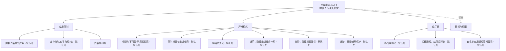
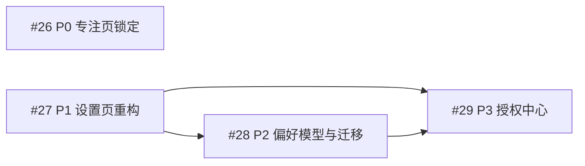

# 学霸模式改版交付方案

> 基于当前代码：[StudyModeSheet.vue](file:///e:/codexseeson/fanqiezhong/src/components/StudyModeSheet.vue)、[EnhancedProtectionSettings.vue](file:///e:/codexseeson/fanqiezhong/src/components/EnhancedProtectionSettings.vue)、[FocusView.vue](file:///e:/codexseeson/fanqiezhong/src/views/FocusView.vue)、[App.vue](file:///e:/codexseeson/fanqiezhong/src/App.vue#L77-L87)、[model.ts](file:///e:/codexseeson/fanqiezhong/src/domain/model.ts)

## 一、现状问题（从用户角度看）

| 问题 | 现象 | 后果 |
|---|---|---|
| 能从专注页“逃回”待办 | 左上角返回键、Android 返回键都 `replace('/tasks')` | 学霸模式形同虚设 |
| 平铺 11 个开关 | 学霸 / 严格 / 声音免打扰 / 通知拦截 / 白名单 / 6 项“更多保护”混在一起 | 用户分不清哪个是主开关、哪个依赖哪个 |
| 每行一个 `!` 和“本机不支持 / 仅 Android 可用” | 同一句话重复 8 次 | 视觉噪音大，像报错页 |
| 授权散落在各个开关里 | 每个开关各自弹“无障碍权限用途” | 用户不知道总共要给几个权限 |
| “锁机时限制主界面入口” 放在专注设置里 | 它只对锁机生效 | 放错位置 |

---

## 二、对你的 5 个选项的评估

| 你的选项 | 评价 | 建议 |
|---|---|---|
| 1 学霸模式开关 | ✅ 正确，作为**总开关** | 保留，放顶部卡片 |
| 2 严格模式 | ✅ 保留，但**扩容** | 把 6 项“更多保护”里防退出类收进来，严格 = “停不下 + 退不出” |
| 3 白名单应用 | ⚠️ 白名单只是“应用限制”的参数 | 改名 **应用限制**，详情页里编辑白名单 |
| 4 免打扰开关 | ✅ 保留，但**合并** | “声音免打扰”+“通知拦截”合并为一个免打扰，下设子项 |
| 5 授权 | ❌ 它不是“模式”，不该和开关平级 | 改为**状态条 + 权限中心入口**：只列出你已开启功能真正需要的权限 |

结论：结构基本按你的思路走，但变成 **1 个总开关 + 3 个模块 + 1 个权限入口**。

---

## 三、新的信息架构



“锁机时限制主界面入口” → **移到锁机配置页**，不再出现在这里。

### 功能归类对照（旧 → 新）

| 旧字段 / 开关 | 新位置 |
|---|---|
| `study` | 学霸总开关 + 应用限制·限制白名单外应用 |
| `globalWhitelist` | 应用限制 → 白名单 |
| 临时放行（现为隐含规则） | 应用限制 → 允许临时放行 |
| `strict` | 严格模式 → 倒计时不可暂停/提前结束 |
| `navigationHomeRecents` | 严格模式 → 限制桌面与最近任务 |
| `preciseAntiClose` | 严格模式 → 精确防关闭 |
| `recentTasksHidden` / `launcherIconHidden` / `wallpaperProtection` | 严格模式 → 进阶 |
| `dnd` | 免打扰 → 静音与振动 |
| `interceptNotifications` | 免打扰 → 拦截通知 |
| `lockMainInterfaceRestricted` | 锁机配置页 |

---

## 四、UI 线框

### 4.1 学霸模式主页（Sheet）

```
┌ 学霸模式 ─────────────────────── ✕ ┐
│ ┌──────────────────────────────┐ │
│ │ 学霸模式                ●━━  │ │  ← 总开关
│ │ 专注期间锁定专注页，限制分心  │ │
│ │ ⚠ 还差 1 项授权  去处理 ›    │ │  ← 状态条（就绪时显示 ✅ 已就绪）
│ └──────────────────────────────┘ │
│                                  │
│ 🛡 应用限制   默认 · 8 个应用 ●━ › │
│ ⏱ 严格模式   已自定义 · 4 项  ━○ › │
│ 🔕 免打扰     默认 · 3 项     ●━ › │
│ ──────────────────────────────── │
│ 🔑 授权与权限        1 项待处理 › │
│ 使用帮助 · 故障恢复              │
│ [            完成            ]  │
└──────────────────────────────────┘
```

规则：
- 每行 = **开关**（控制模块整体）+ **点行进入详情**（控制子项）。
- 摘要文字固定格式：`默认 / 已自定义 · N 项`，用户一眼知道是否改过。
- 总开关关闭时，三个模块**灰显但仍可点进去预先配置**（例如提前编辑白名单）。
- 平台不支持（Web/非 Android）只在顶部卡片显示一次，**不再每行重复**。
- 去掉每行的 `!`；说明文字放进详情页顶部一行副标题。

### 4.2 模块详情页（以严格模式为例）

```
┌ ‹ 严格模式 ─────────────────── ●━━ ┐
│ 开始后更难中途放弃                  │
│                                    │
│ 计时约束                           │
│  倒计时不可暂停、不可提前结束  ●━  │
│  （正计时不受影响）                 │
│                                    │
│ 防退出                             │
│  限制桌面与最近任务   需无障碍  ●━  │
│  精确防关闭           需无障碍  ●━  │
│                                    │
│ 进阶 · 可能影响日常使用             │
│  隐藏最近任务卡片               ━○  │
│  隐藏桌面图标                   ━○  │
│  壁纸辅助保护                   ━○  │
│                                    │
│ [ 恢复默认 ]                        │
└────────────────────────────────────┘
```

子项右侧若权限缺失，显示 `待授权 · 未生效`，点击直接跳对应授权。

### 4.3 授权与权限（原选项 5）

只列出**当前已开启子项需要的**权限，按“必需 / 可选”分组：

| 权限 | 被谁用到 | 级别 |
|---|---|---|
| 无障碍 | 应用限制、限制桌面与最近任务、精确防关闭 | 必需（开学霸即需要） |
| 免打扰权限 | 免打扰·静音与振动 | 可选 |
| 通知使用权 | 免打扰·拦截通知 | 可选 |
| 通知权限 | 隐藏桌面图标的备用入口 | 可选 |
| 壁纸 | 壁纸辅助保护 | 可选 |

---

## 五、“默认开启 + 记住自定义” 规则

这是你提的核心逻辑，规则化如下：

1. **首次打开模块** → 子项按“推荐默认”开启。
2. **用户改过任一子项** → 该模块标记为“已自定义”，保存子项状态。
3. **关闭再打开模块** → 恢复用户上次的自定义，不重置。
4. **“恢复默认”按钮** → 清除自定义，回到推荐默认。
5. **总开关同理**：首次开启 → 各模块按默认启用；之后关/开总开关 → 模块保持各自上次状态。
6. **专注进行中修改** → 仅对下一轮生效（沿用现有规则，本轮设置在开始时固定）。

### ⚠️ 我对“默认全部开启”的修正建议

| 项 | 建议默认 | 理由 |
|---|---|---|
| 首次开学霸时 **严格模式** | **关** | 新用户第一次开 60 分钟倒计时、停不下、退不出、应用被拦 → 极易直接卸载。严格模式应由用户主动开启，并保留现有开始前二次确认 |
| 隐藏桌面图标 | 关 | 用户会以为 App 被卸载 |
| 壁纸辅助保护 | 关 | 需要系统壁纸选择器交互，会改用户壁纸 |
| 隐藏最近任务卡片 | 关 | 影响多任务切换习惯 |
| 其余子项 | 开 | 低风险、高收益 |

也就是说：“默认”= **推荐配置**，而不是“全开”。

---

## 六、学霸专注页锁定（你提的第一个需求）

**规则：本轮专注快照 `session.protection.study === true` 时，专注页锁定，直到本轮结束。**（看的是本轮快照，不是偏好，避免专注中关偏好就能解锁。）

| 入口 | 现状 | 改后 |
|---|---|---|
| 左上角返回箭头 | 回待办 | 替换为 🔒 图标，点击提示“学霸模式进行中，结束后可返回” |
| Android 返回键 | 回待办 | 不导航，弹同样的提示 |
| 路由跳转（任何途径） | 不拦 | 全局守卫：专注中只允许 `/focus` `/rest` `/permissions` `/help` `/emergency` `/recovery` |
| 结束专注按钮 | 有 | 保留（非严格模式）；严格模式下按现有规则不可结束 |
| 帮助 / 紧急 / 故障恢复 | 有 | **必须保留可达**（ADR 0004 要求的出口），从这些页返回时回 `/focus` |

不开学霸模式时行为不变（仍可返回待办，计时继续）。

---

## 七、数据与实现要点

- 新增偏好结构（示意）：
  ```ts
  interface ModulePref<K extends string> { enabled: boolean; custom?: Partial<Record<K, boolean>> }
  interface ProtectionPreferences {
    study: boolean
    apps: ModulePref<'restrict' | 'temporaryAccess'>
    strict: ModulePref<'noPauseEnd' | 'navigation' | 'antiClose' | 'hideRecents' | 'hideLauncher' | 'wallpaper'>
    quiet: ModulePref<'sound' | 'intercept' | 'whitelistPass'>
    globalWhitelist: string[]
  }
  ```
- 新增纯函数 `resolveEffectiveProtection(prefs)`：在开始专注时把新结构**展开成现有扁平字段**（`study/strict/dnd/interceptNotifications/enhancements`）交给原生。→ **原生层与会话快照基本不用改**，风险最低。
- 迁移：旧数据按“对照表”映射；与推荐默认不一致的模块自动标记为“已自定义”，保证老用户升级后行为不变。备份导入（`backup.ts`）走同一迁移。
- 组件：`StudyModeSheet` 重写为主页 + 3 个详情子 Sheet；现有各 `*Setting.vue` 的授权/状态逻辑下沉为子项行复用，`EnhancedProtectionSettings` 拆散。
- 文档：`GLOSSARY.md` 需更新“学霸模式（总开关）”“免打扰（合并通知拦截）”“严格模式（含防退出）”。注意：术语表现写“严格模式与是否限制应用分别选择”——新方案中它们仍是独立子模块、可分别开关，**不冲突**；但“免打扰从属学霸总开关”是**语义变化**，需在 ADR 0004 追加说明。

---

## 八、分期交付

| 期 | 内容 | 验收标准 |
|---|---|---|
| **P0**（可立即做） | 学霸专注页锁定 | 学霸专注中：返回箭头、Android 返回、地址/路由跳转均回不到待办；帮助/紧急/故障恢复可达并能回到专注页；非学霸专注行为不变；单测覆盖路由守卫 |
| **P1** | 主页 + 详情页 UI 重构（先用旧字段驱动） | 主页 ≤ 5 行；不支持提示只出现 1 次；所有旧能力在新位置可找到；“锁机主界面入口”移入锁机配置 |
| **P2** | 默认/自定义数据模型 + 迁移 + 备份兼容 | 第五节 6 条规则全部有单测；老数据升级后有效保护与升级前一致 |
| **P3** | 授权与权限中心 + 开启后授权引导清单 | 开总开关后弹出“还需 N 项授权”清单逐项引导；子项缺权限显示“待授权 · 未生效”；开始专注摘要如实反映实际生效项 |

---

## 九、决定记录

当前按推荐方案执行；用户改变决定时，同步更新本节、父 Issue 与对应子任务。

| 编号 | 决定 | 状态 | 影响 |
|---|---|---|---|
| D1 | 首次开启学霸时严格模式默认 **关** | 已确认并实施 | P2 |
| D2 | 6 项防退出能力 **并入严格模式** | 已确认并实施 | P1 |
| D3 | 免打扰 **从属学霸总开关**（与 GLOSSARY 现有表述相比是语义变化，需在 ADR 0004 追加说明） | 已确认并实施 | P1、P2 |
| D4 | P0 专注页锁定 **先单独交付** | 已确认并实施 | P0 |

## 十、开发计划（GitHub Issues）

父 Issue：[#25 学霸模式改版](https://github.com/cjx-bc/kitten-focus/issues/25)（`ready-for-agent`）

| 期 | Issue | 标签 | 依赖 |
|---|---|---|---|
| P0 | [#26 学霸专注期间锁定专注页](https://github.com/cjx-bc/kitten-focus/issues/26) | `ready-for-agent` | 无 |
| P1 | [#27 重构学霸设置页](https://github.com/cjx-bc/kitten-focus/issues/27) | `ready-for-agent` | 无 |
| P2 | [#28 默认开启 + 记住自定义、迁移与备份兼容](https://github.com/cjx-bc/kitten-focus/issues/28) | `ready-for-agent` | #27 |
| P3 | [#29 授权与权限中心及开启引导](https://github.com/cjx-bc/kitten-focus/issues/29) | `ready-for-agent` | #27、#28 |



D1–D3 确认后，将 #25、#27、#28 的标签由 `needs-info` 改为 `ready-for-agent`。
